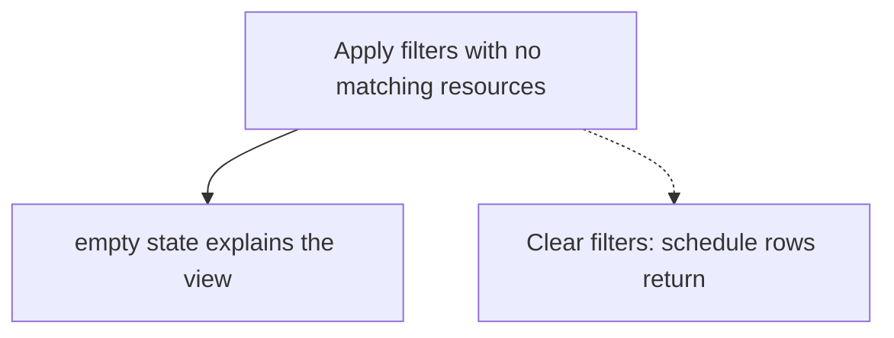
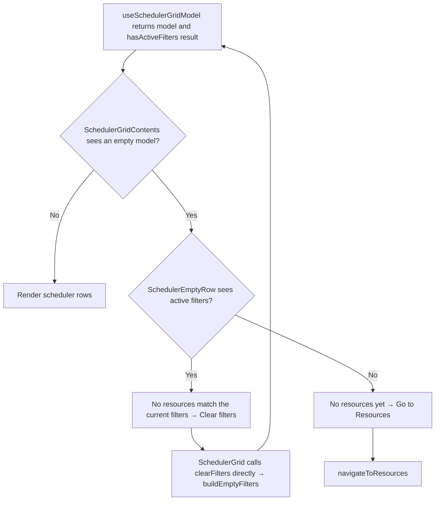

# US-FIL-07 — Empty state when no resource matches

As a company member, I want a clear empty state when filters match no resources so that I know the schedule is filtered rather than missing data.

**Status:** Current

**Access:** Viewer, Editor, Admin or Owner

**Entry:** Schedule (`/`)

**Documentation:** [schedule-work.md](../../docs-src/using/schedule-work.md)

**Source:** [SchedulerToolbarSections.tsx](../../apps/frontend/src/components/scheduler/SchedulerToolbarSections.tsx)

## Acceptance criteria

- When filters leave no resource rows, the Schedule shows **No resources match the current filters.** with a **Clear filters** action.
- Clearing the filters restores the schedule rows.

## User flow

## Code flow

These controls use in-memory schedule filters for any role that can open Schedule, including Viewer and view-as-member. Recomputing after Clear filters produces eligible rows or the unfiltered empty state. The grid’s store action replaces the filter object, so the toolbar reconciles its draft and cancels its pending debounce.

**Code references:** [useSchedulerGridModel.ts](../../apps/frontend/src/components/scheduler/useSchedulerGridModel.ts#L220) · [SchedulerGrid.tsx](../../apps/frontend/src/components/scheduler/SchedulerGrid.tsx#L208) · [SchedulerGrid.tsx](../../apps/frontend/src/components/scheduler/SchedulerGrid.tsx#L68) · [SchedulerGrid.tsx](../../apps/frontend/src/components/scheduler/SchedulerGrid.tsx#L378) · [schedulerSlice.ts](../../apps/frontend/src/store/slices/schedulerSlice.ts#L138) · [useToolbarSearch.ts](../../apps/frontend/src/components/scheduler/useToolbarSearch.ts#L25) · [SchedulerGrid.test.tsx](../../apps/frontend/src/components/scheduler/SchedulerGrid.test.tsx#L457)
