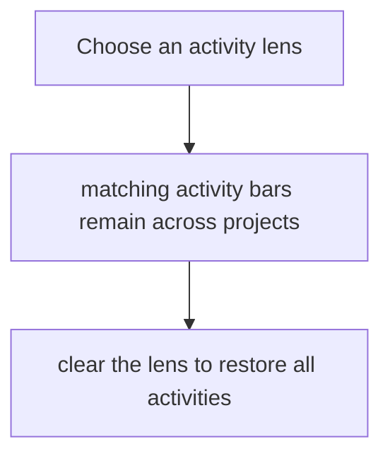
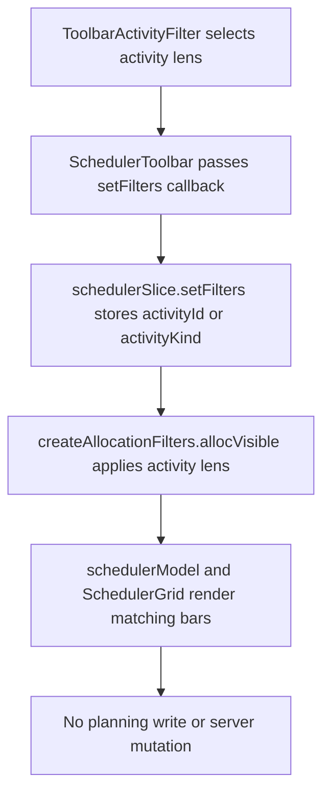

# US-FIL-08 — Filter by activity (the activity lens)

As a company member, I want an activity lens across projects so that I can review internal or All projects work by activity.

**Status:** Current

**Access:** Viewer, Editor, Admin or Owner

**Entry:** Schedule (`/`)

**Documentation:** [schedule-work.md](../../docs-src/using/schedule-work.md)

**Source:** [SchedulerToolbarSections.tsx](../../apps/frontend/src/components/scheduler/SchedulerToolbarSections.tsx)

## Acceptance criteria

- **Filter by activity** offers **All activities**, then an **Internal** group (**Internal — All**, then internal activities by name) and an **All projects** group (**All projects — All**, then all-projects activities by name). Project-specific activities are not listed; they are reached through **Filter by project**.
- Choosing **Internal — All** or **All projects — All** shows only work on activities of that kind; choosing one activity shows only its work.
- The activity lens and the client/project lens are exclusive: choosing an activity resets **Filter by client** and **Filter by project** to All, and choosing a client or project resets **Filter by activity** to **All activities**.
- **Show unallocated** works under the activity lens. The dropdown is absent when the company has no internal or all-projects activities and no activity lens is selected.

## User flow

## Code flow

**Code references:**

- [schedulerSlice.ts](../../apps/frontend/src/store/slices/schedulerSlice.ts)
- [SchedulerToolbarSections.tsx](../../apps/frontend/src/components/scheduler/SchedulerToolbarSections.tsx)
- [SchedulerToolbar.tsx](../../apps/frontend/src/components/scheduler/SchedulerToolbar.tsx)
- [schedulerModelFilters.ts](../../apps/frontend/src/components/scheduler/schedulerModelFilters.ts)
- [schedulerModel.ts](../../apps/frontend/src/components/scheduler/schedulerModel.ts)
- [SchedulerGrid.tsx](../../apps/frontend/src/components/scheduler/SchedulerGrid.tsx)
