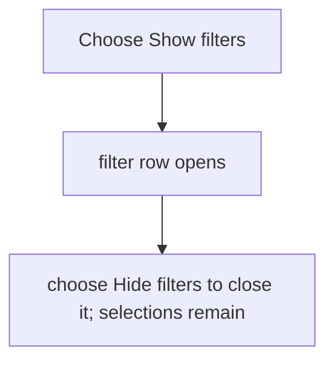
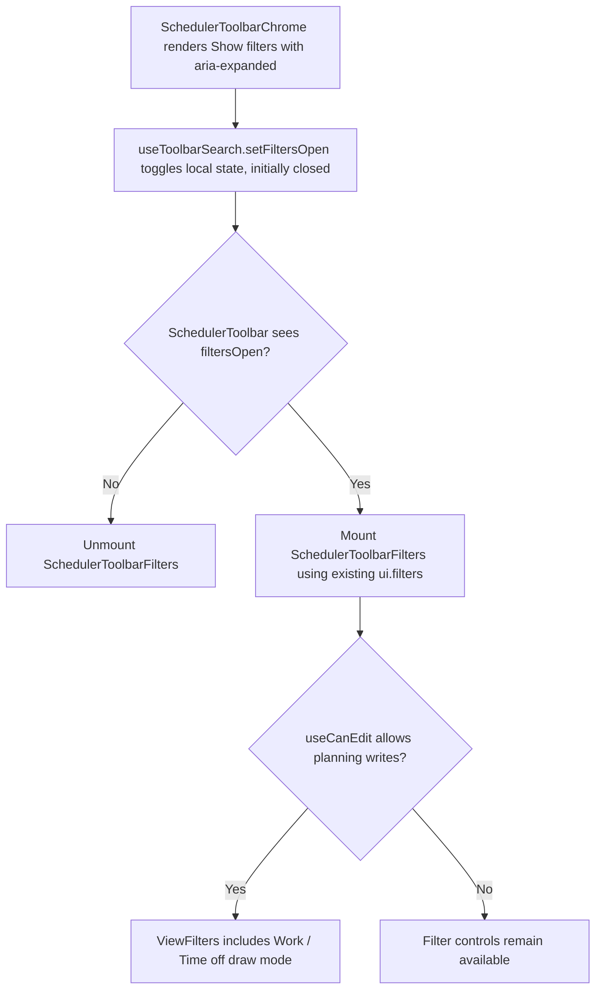

# US-FIL-09 — Show or hide the schedule filters

As a company member, I want to show or hide the filter row so that I can keep the Schedule compact when filters are not needed.

**Status:** Current

**Access:** Viewer, Editor, Admin or Owner

**Entry:** Schedule (`/`)

**Documentation:** [schedule-work.md](../../docs-src/using/schedule-work.md)

**Source:** [SchedulerToolbarSections.tsx](../../apps/frontend/src/components/scheduler/SchedulerToolbarSections.tsx)

## Acceptance criteria

- **Show filters** opens the filter row and changes to **Hide filters**; hiding it removes those controls from view.
- The expanded row contains **Search people…**, the discipline, client, project and activity filters that apply, **Tentative**, the Work / Time off draw mode for Editors and above, **Show unallocated** while a client, project or activity filter is set, and **Clear Filters**.

## User flow

## Code flow

These controls use in-memory schedule filters for any role that can open Schedule, including Viewer and view-as-member. The row toggle changes component state only. Discipline and activity controls depend on settings or active options and retained selections. Show unallocated requires a work lens.

**Code references:** [SchedulerToolbarSections.tsx](../../apps/frontend/src/components/scheduler/SchedulerToolbarSections.tsx#L100) · [useToolbarSearch.ts](../../apps/frontend/src/components/scheduler/useToolbarSearch.ts#L23) · [SchedulerToolbar.tsx](../../apps/frontend/src/components/scheduler/SchedulerToolbar.tsx#L80) · [SchedulerToolbarSections.tsx](../../apps/frontend/src/components/scheduler/SchedulerToolbarSections.tsx#L111) · [SchedulerToolbarSections.tsx](../../apps/frontend/src/components/scheduler/SchedulerToolbarSections.tsx#L152) · [SchedulerToolbar.test.tsx](../../apps/frontend/src/components/scheduler/SchedulerToolbar.test.tsx#L127)
