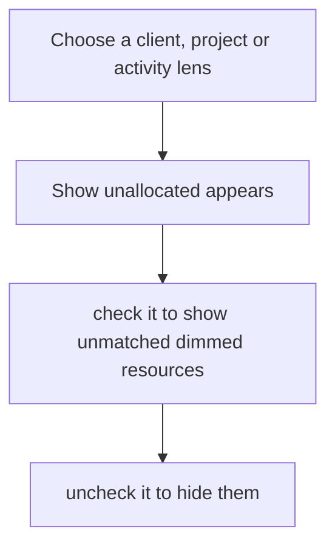
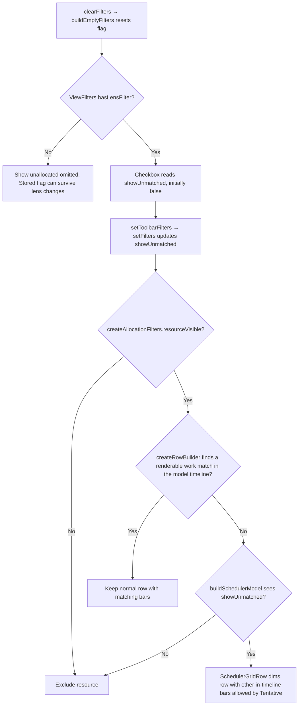

# US-FIL-10 — Show resources without matching work

As a company member, I want to show unallocated resources while a client, project or activity lens is active so that I can see who has capacity outside the filtered work.

**Status:** Current

**Access:** Viewer, Editor, Admin or Owner

**Entry:** Schedule (`/`), expanded filter row, after selecting a client, project or activity lens

**Documentation:** [schedule-work.md](../../docs-src/using/schedule-work.md)

**Source:** [SchedulerToolbarSections.tsx](../../apps/frontend/src/components/scheduler/SchedulerToolbarSections.tsx)

## Acceptance criteria

- **Show unallocated** is an unchecked checkbox shown only when a client, project or activity lens is active.
- Checking it restores resources without matching work as visible, dimmed rows; their capacity figures remain based on all work.

## User flow

## Code flow

These controls use in-memory schedule filters for any role that can open Schedule, including Viewer and view-as-member. The resource predicate applies enabled kinds, search and any applicable discipline. Server capacity remains a separate row-builder input. Clearing the last lens hides the checkbox; a later lens can show it checked until Clear Filters resets it.

**Code references:** [SchedulerToolbarSections.tsx](../../apps/frontend/src/components/scheduler/SchedulerToolbarSections.tsx#L152) · [useToolbarSearch.ts](../../apps/frontend/src/components/scheduler/useToolbarSearch.ts#L47) · [schedulerSlice.ts](../../apps/frontend/src/store/slices/schedulerSlice.ts#L80) · [filters.ts](../../apps/frontend/src/store/filters.ts#L23) · [schedulerModelFilters.ts](../../apps/frontend/src/components/scheduler/schedulerModelFilters.ts#L11) · [schedulerRowModel.ts](../../apps/frontend/src/components/scheduler/schedulerRowModel.ts#L164) · [schedulerRowModel.ts](../../apps/frontend/src/components/scheduler/schedulerRowModel.ts#L66) · [schedulerModel.ts](../../apps/frontend/src/components/scheduler/schedulerModel.ts#L208) · [SchedulerGridRow.tsx](../../apps/frontend/src/components/scheduler/SchedulerGridRow.tsx#L241) · [schedulerModel.filters.test.ts](../../apps/frontend/src/components/scheduler/schedulerModel.filters.test.ts#L186)
