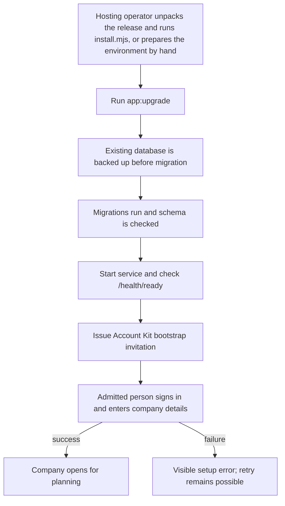
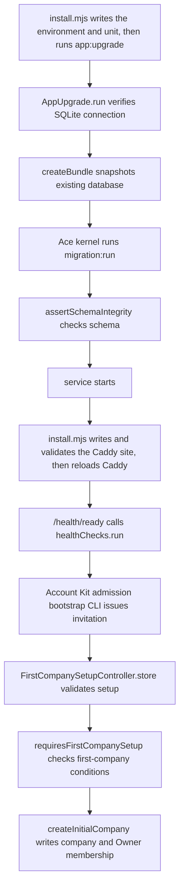

# US-INS-01 — Install and operate one agency instance

As a hosting operator, I want to install and maintain the release on a host so that one agency can use a secure persisted service.

**Status:** Operator

**Access:** Hosting operator; company Owner completes browser company setup

**Entry:** Release archive install command, or manual environment configuration, upgrade and health commands

**Documentation:** [Install](../../docs-src/self-hosting/install.md); [Install without Docker](../../docs-src/self-hosting/install-without-docker.md); [Upgrades](../../docs-src/self-hosting/upgrades.md)

**Source:** [commands](../../apps/backend/commands); [start](../../apps/backend/start); [packaging](../../packaging)

## Acceptance criteria

- A native release archive runs with configured secrets, database and HTTPS origin; `app:upgrade` backs up an existing database before migrating, `/health/ready` checks database readiness, and initial Owner admission uses the bootstrap invitation. No Docker task is included in this story.
- From the unpacked archive, `sudo node install.mjs` asks for the public HTTPS address, the Owner's email address and mail settings (or takes them as options), writes the root-only environment file with generated secrets, installs and starts the systemd unit, writes a same-machine Caddy site or prints the settings for another proxy, enables scheduled backups and prints the setup link.
- Re-running the command keeps the environment file and its secrets and the recorded proxy choice, refuses a changed setting without `--update-env`, finishes a first install that stopped before its setup link and otherwise prints a link only for `--owner-email`. Every run waits for readiness, and for HTTPS when Caddy is managed. Run from a newer release, it stops the service, switches `current`, runs `app:upgrade` and starts the service only after the upgrade succeeds.

## User flow

## Code flow

**Code references:** [install.mjs](../../packaging/release/install.mjs); [app_upgrade.ts](../../apps/backend/commands/app_upgrade.ts); [routes.ts](../../apps/backend/start/routes.ts); [health.ts](../../apps/backend/start/health.ts); [first_company_setup_controller.ts](../../apps/backend/app/controllers/first_company_setup_controller.ts); [first_company_setup.ts](../../apps/backend/app/services/first_company_setup.ts); [initial_company_defaults.ts](../../apps/backend/app/services/initial_company_defaults.ts); [install.md](../../docs-src/self-hosting/install.md); [configuration.md](../../docs-src/self-hosting/configuration.md)
