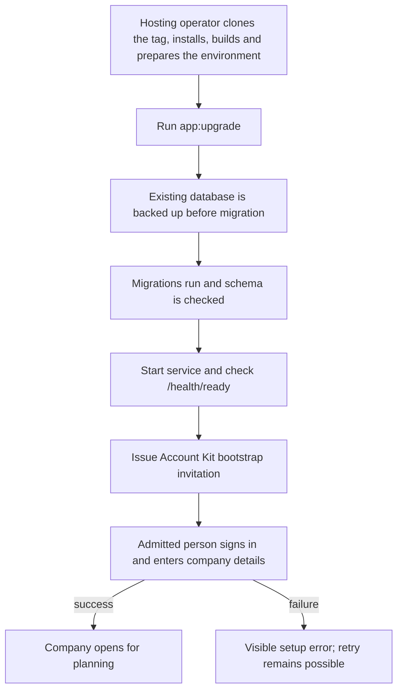
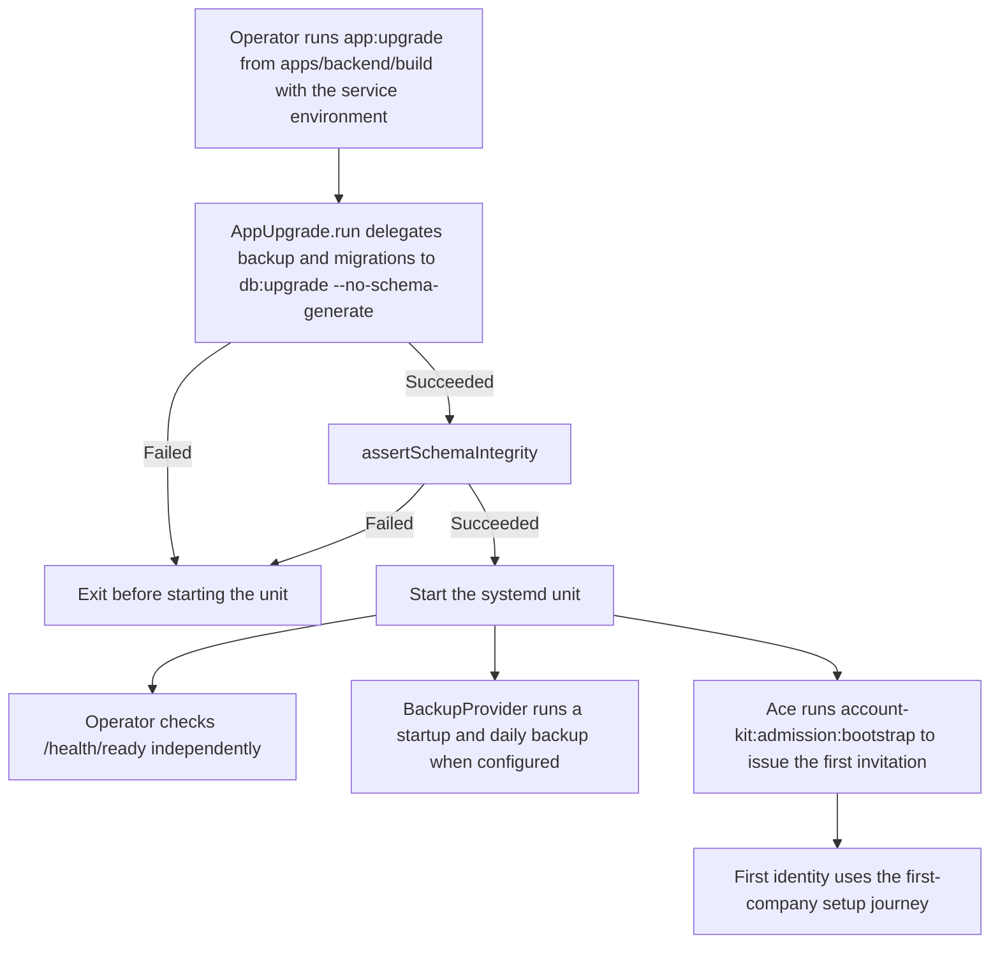

# US-INS-01 — Install and operate one agency instance

As a hosting operator, I want to install and maintain the release on a host so that one agency can use a secure persisted service.

**Status:** Operator

**Access:** Hosting operator; company Owner completes browser company setup

**Entry:** Clone at a release tag, environment configuration, upgrade and health commands

**Documentation:** [Install](../../docs-src/self-hosting/install.md); [Install without Docker](../../docs-src/self-hosting/install-without-docker.md); [Upgrades](../../docs-src/self-hosting/upgrades.md)

**Source:** [commands](../../apps/backend/commands); [start](../../apps/backend/start); [packaging](../../packaging)

## Acceptance criteria

- A clone of the repository at a release tag, installed and built, runs with configured secrets, database and HTTPS origin; `app:upgrade` backs up an existing database before migrating, `/health/ready` checks database readiness, and initial Owner admission uses the bootstrap invitation. No Docker task is included in this story.
- The operator writes the root-only environment file, runs `app:upgrade` from `apps/backend/build`, installs and starts the systemd unit, puts an HTTPS proxy in front and prints the setup link with the bootstrap command. Scheduled backups run in the service.
- An upgrade stops the service, checks out a newer tag, installs, builds, runs `app:upgrade` and starts the service only after the upgrade succeeds.

## User flow

## Code flow

See [Set up and open the installation company](../navigation/US-NAV-14-company-picker-setup.md#code-flow) for the browser continuation.

**Code references:** [Ace command registration](../../apps/backend/adonisrc.ts#L28) · [app_upgrade.ts](../../apps/backend/commands/app_upgrade.ts#L13) · [routes.ts](../../apps/backend/start/routes.ts#L62) · [backup_provider.ts](../../apps/backend/providers/backup_provider.ts#L46) · [install-without-docker.md](../../docs-src/self-hosting/install-without-docker.md)
