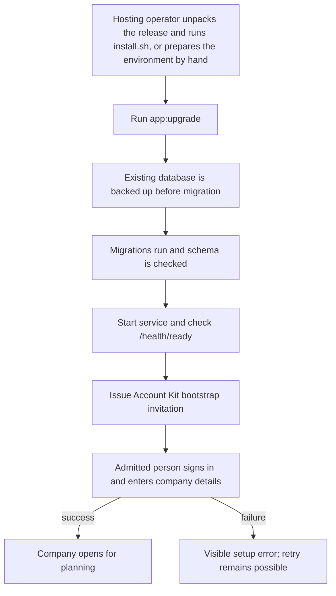
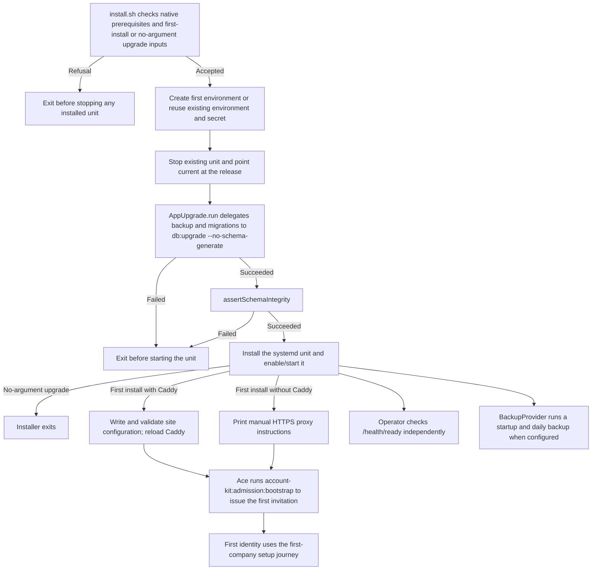

# US-INS-01 — Install and operate one agency instance

As a hosting operator, I want to install and maintain the release on a host so that one agency can use a secure persisted service.

**Status:** Operator

**Access:** Hosting operator; company Owner completes browser company setup

**Entry:** Release archive install command, or manual environment configuration, upgrade and health commands

**Documentation:** [Install](../../docs-src/self-hosting/install.md); [Install without Docker](../../docs-src/self-hosting/install-without-docker.md); [Upgrades](../../docs-src/self-hosting/upgrades.md)

**Source:** [commands](../../apps/backend/commands); [start](../../apps/backend/start); [packaging](../../packaging)

## Acceptance criteria

- A native release archive runs with configured secrets, database and HTTPS origin; `app:upgrade` backs up an existing database before migrating, `/health/ready` checks database readiness, and initial Owner admission uses the bootstrap invitation. No Docker task is included in this story.
- From the unpacked archive, `sudo sh install.sh DOMAIN OWNER_EMAIL` writes the root-only environment file with generated secrets, runs `app:upgrade`, installs and starts the systemd unit, writes a same-machine Caddy site when Caddy is installed (otherwise prints the address to proxy to) and prints the setup link. Scheduled backups run in the service.
- Running the command again keeps the environment file and its secrets. Run without arguments from a newer release, it stops the service, switches `current`, runs `app:upgrade` and starts the service only after the upgrade succeeds.

## User flow

## Code flow

See [Set up and open the installation company](../navigation/US-NAV-14-company-picker-setup.md#code-flow) for the browser continuation.

**Code references:** [install.sh](../../packaging/release/install.sh#L32) · [install.sh](../../packaging/release/install.sh#L49) · [Installer stop and restart ordering](../../packaging/release/install.sh#L65) · [Bootstrap command](../../packaging/release/install.sh#L88) · [Ace command registration](../../apps/backend/adonisrc.ts#L27) · [app_upgrade.ts](../../apps/backend/commands/app_upgrade.ts#L13) · [routes.ts](../../apps/backend/start/routes.ts#L57) · [backup_provider.ts](../../apps/backend/providers/backup_provider.ts#L45) · [install-without-docker.md](../../docs-src/self-hosting/install-without-docker.md#L143)
