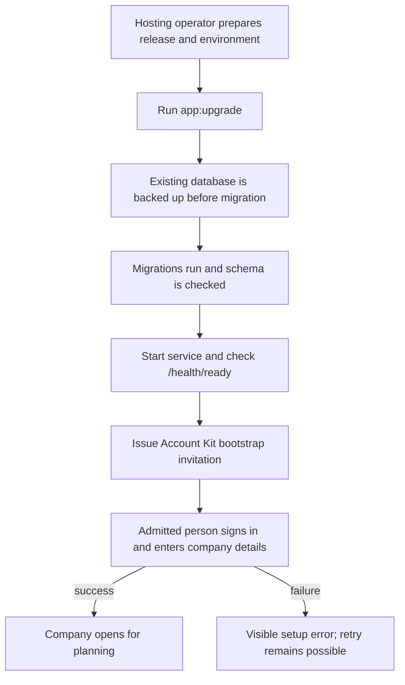
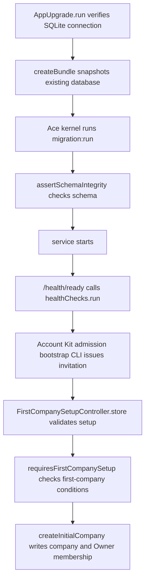

# US-INS-01 — Install and operate one agency instance

As a hosting operator, I want to install and maintain the release on a host so that one agency can use a secure persisted service.

**Status:** Operator

**Access:** Hosting operator; company Owner completes browser company setup

**Entry:** Release archive, environment configuration, upgrade and health commands

**Documentation:** [Install](../../docs-src/self-hosting/install.md)

**Source:** [commands](../../apps/backend/commands); [start](../../apps/backend/start); [packaging](../../packaging)

## Acceptance criteria

- A native release archive runs with configured secrets, database and HTTPS origin; `app:upgrade` backs up an existing database before migrating, `/health/ready` checks database readiness, and initial Owner admission uses the bootstrap invitation. No Docker task is included in this story.

## User flow

## Code flow

**Code references:** [app_upgrade.ts](../../apps/backend/commands/app_upgrade.ts); [routes.ts](../../apps/backend/start/routes.ts); [health.ts](../../apps/backend/start/health.ts); [first_company_setup_controller.ts](../../apps/backend/app/controllers/first_company_setup_controller.ts); [first_company_setup.ts](../../apps/backend/app/services/first_company_setup.ts); [initial_company_defaults.ts](../../apps/backend/app/services/initial_company_defaults.ts); [install.md](../../docs-src/self-hosting/install.md); [configuration.md](../../docs-src/self-hosting/configuration.md)
