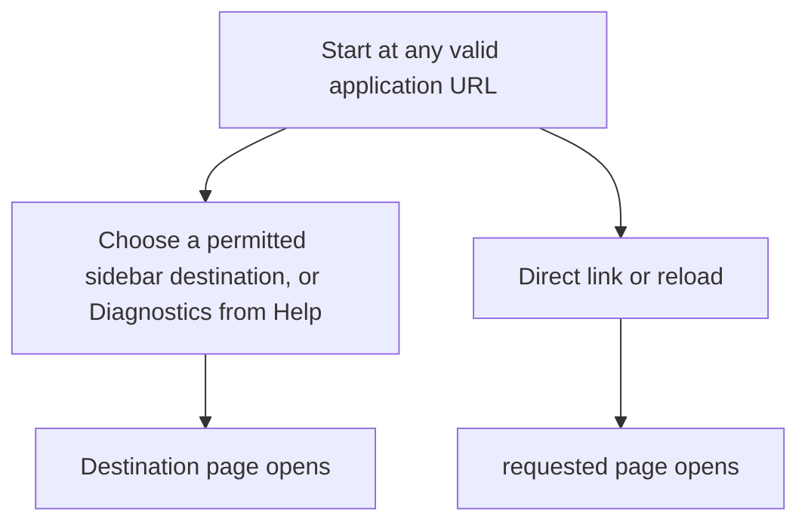
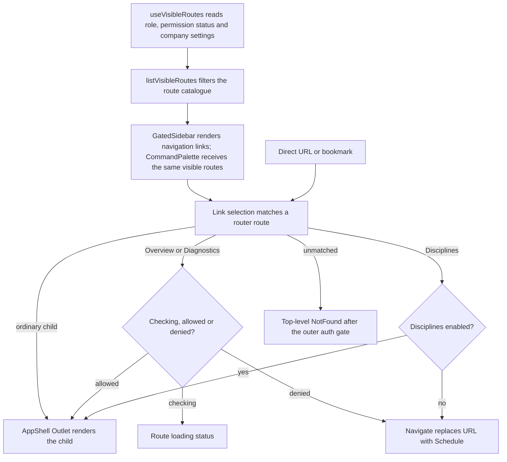

# US-NAV-01 — Navigate permitted sections

As an Owner, Admin, Editor, or Viewer, I want to open the sections available to my role so that I can reach my company work.

**Status:** Current

**Access:** Owner, Admin, Editor, Viewer; section visibility and write controls follow role permissions.

**Entry:** Sidebar links; direct route; command palette

**Documentation:** [Settings](../../docs-src/using/settings.md)

**Source:** [AppSidebar.tsx](../../apps/frontend/src/components/AppSidebar.tsx); [AppShell.tsx](../../apps/frontend/src/components/AppShell.tsx)

## Acceptance criteria

- Selecting a permitted destination renders its page and preserves valid deep links; unknown routes show the not-found page. A direct link to Overview or Diagnostics without access, or to Disciplines while disciplines are off, returns to the Schedule. The sidebar lists the working destinations, **Team & access** and **Settings**, then **Help** and **Account**; Diagnostics is reached from Help or the command palette, not the sidebar.

## User flow

## Code flow

This trace starts after authentication. See [US-NAV-18](US-NAV-18-not-found-route.md#code-flow) for the signed-out and unmatched URL paths.

**Code references:** [useVisibleRoutes.ts:37](../../apps/frontend/src/components/useVisibleRoutes.ts#L37) · [navLinks.ts:173](../../apps/frontend/src/lib/navLinks.ts#L173) · [AppShell.tsx:132](../../apps/frontend/src/components/AppShell.tsx#L132) · [CommandPalette.tsx:49](../../apps/frontend/src/components/CommandPalette.tsx#L49) · [router.tsx:113](../../apps/frontend/src/router.tsx#L113) · [router.tsx:238](../../apps/frontend/src/router.tsx#L238)
