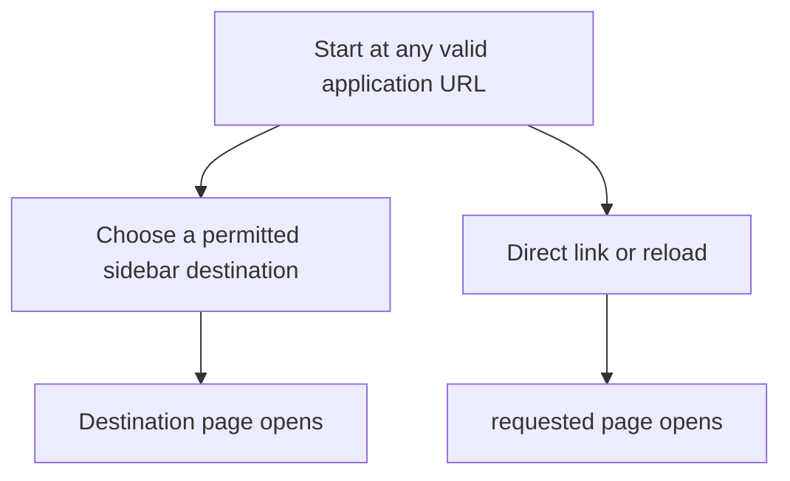
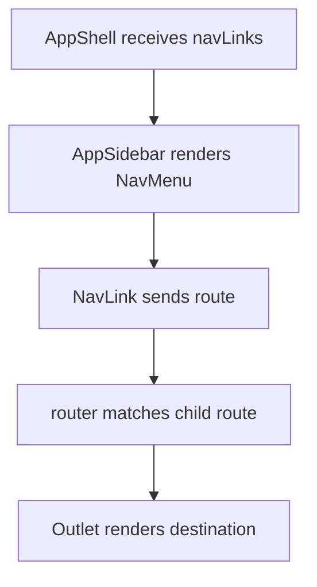

# US-NAV-01 — Navigate permitted sections

As an Owner, Admin, Editor, or Viewer, I want to open the sections available to my role so that I can reach my company work.

**Status:** Current

**Access:** Owner, Admin, Editor, Viewer; section visibility and write controls follow role policy.

**Entry:** Sidebar links; direct route; command palette

**Documentation:** [Settings](../../docs-src/using/settings.md)

**Source:** [AppSidebar.tsx](../../apps/frontend/src/components/AppSidebar.tsx); [AppShell.tsx](../../apps/frontend/src/components/AppShell.tsx)

## Acceptance criteria

- Selecting a permitted destination renders its page and preserves valid deep links; unknown routes show the not-found page.

## User flow

## Code flow

**Code references:** [AppShell.tsx](../../apps/frontend/src/components/AppShell.tsx); [useAppShellController.ts](../../apps/frontend/src/components/useAppShellController.ts); [AppSidebar.tsx](../../apps/frontend/src/components/AppSidebar.tsx); [navLinks.ts](../../apps/frontend/src/lib/navLinks.ts); [router.tsx](../../apps/frontend/src/router.tsx)
