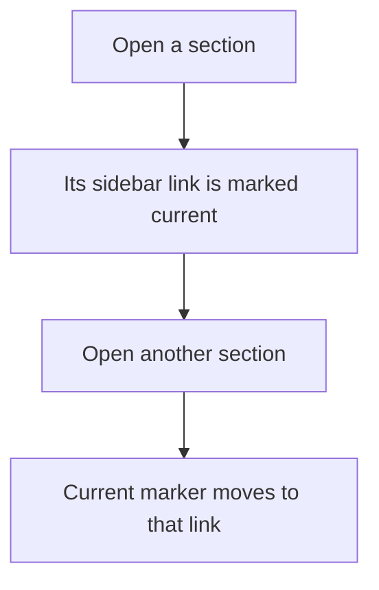
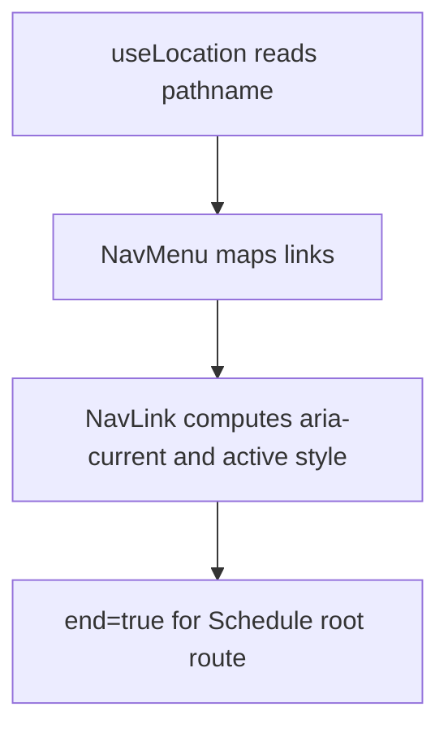

# US-NAV-02 — See the active section

As a company member, I want the current section identified in navigation so that I know where I am.

**Status:** Current

**Access:** Owner, Admin, Editor, Viewer

**Entry:** Current sidebar route link

**Documentation:** [Help](../../docs-src/using/help.md)

**Source:** [AppSidebar.tsx](../../apps/frontend/src/components/AppSidebar.tsx)

## Acceptance criteria

- The current destination is marked as current; the root Schedule link matches only the root route.

## User flow

## Code flow

**Code references:** [AppSidebar.tsx](../../apps/frontend/src/components/AppSidebar.tsx); [navLinks.ts](../../apps/frontend/src/lib/navLinks.ts)
