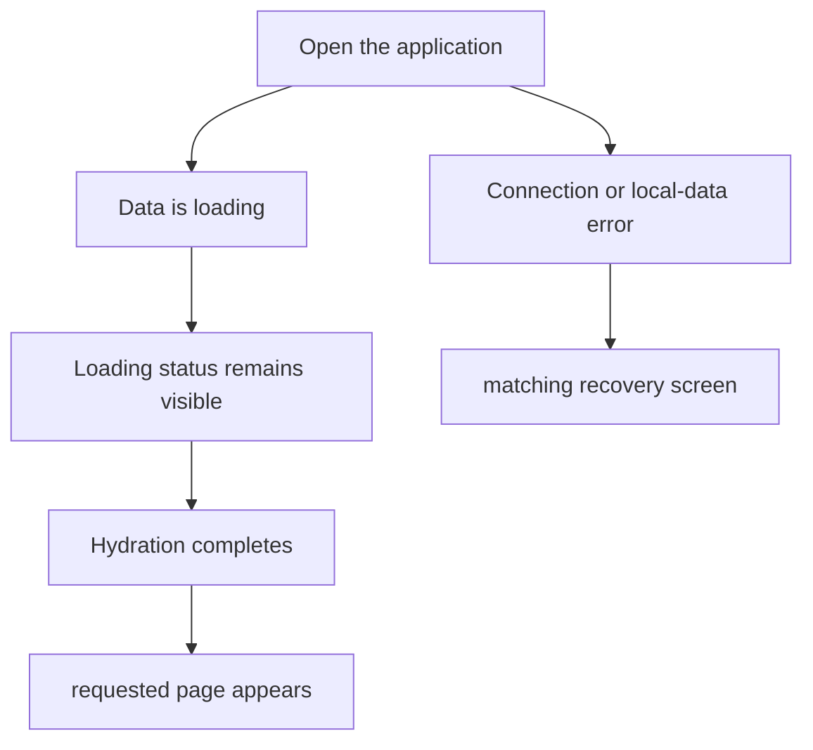
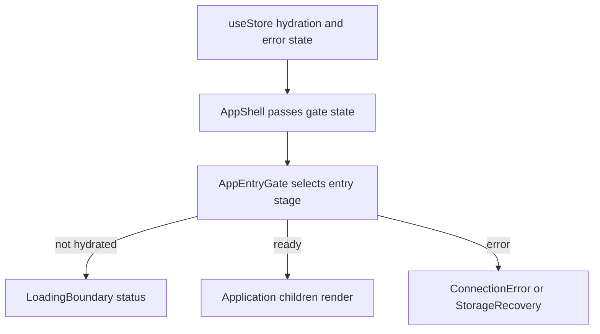

# US-NAV-03 — Wait for company data

As a company member, I want a loading state while company data is read so that incomplete data is not mistaken for an empty schedule.

**Status:** Current

**Access:** Owner, Admin, Editor, Viewer

**Entry:** Application content during initial load

**Documentation:** [Read The Schedule](../../docs-src/using/read-the-schedule.md)

**Source:** [AppShell.tsx](../../apps/frontend/src/components/AppShell.tsx)

## Acceptance criteria

- The page content area shows **Loading…** until the selected data source finishes loading, and again while a member view is starting or ending.

## User flow

## Code flow

**Code references:** [AppShell.tsx](../../apps/frontend/src/components/AppShell.tsx); [AppEntryGate.tsx](../../apps/frontend/src/components/AppEntryGate.tsx); [runtimeSlice.ts](../../apps/frontend/src/store/slices/runtimeSlice.ts)
