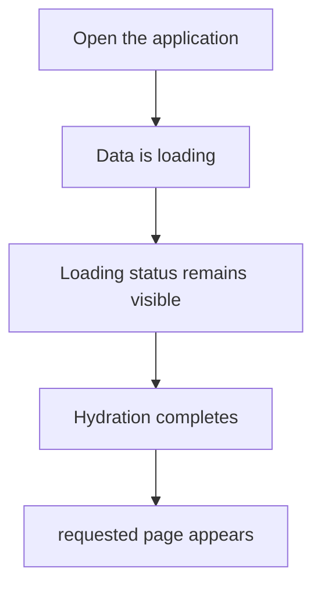
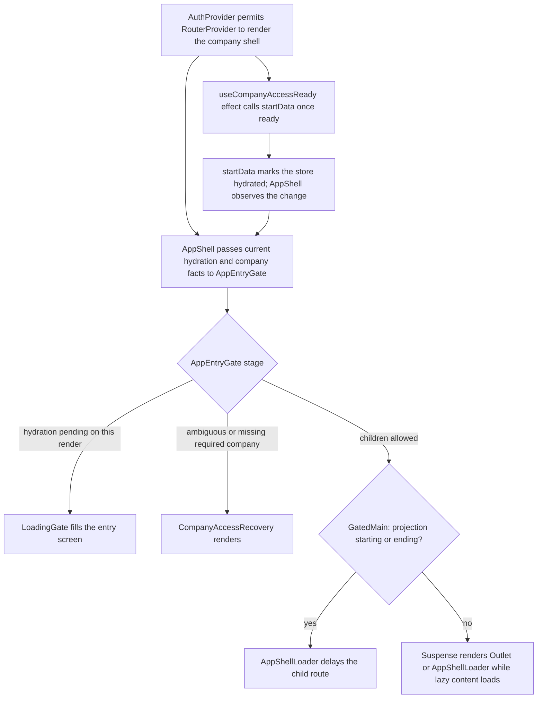

# US-NAV-03 — Wait for company data

As a company member, I want a loading state while company data is read so that incomplete data is not mistaken for an empty schedule.

**Status:** Current

**Access:** Owner, Admin, Editor, Viewer

**Entry:** Application content during initial load

**Documentation:** [Read The Schedule](../../docs-src/using/read-the-schedule.md)

**Source:** [AppShell.tsx](../../apps/frontend/src/components/AppShell.tsx)

## Acceptance criteria

- The page content area shows **Loading…** until the selected data source finishes loading, and again while a view as another member is starting or ending.

## User flow

## Code flow

The planning read notice is a separate shell branch described in [US-NAV-04](US-NAV-04-persist-error-banner.md#code-flow).

**Code references:** [AuthProvider.tsx:33](../../apps/frontend/src/auth/AuthProvider.tsx#L33) · [main.tsx:24](../../apps/frontend/src/main.tsx#L24) · [AppShell.tsx:214](../../apps/frontend/src/components/AppShell.tsx#L214) · [AppEntryGate.tsx:35](../../apps/frontend/src/components/AppEntryGate.tsx#L35) · [AppShell.tsx:151](../../apps/frontend/src/components/AppShell.tsx#L151)
