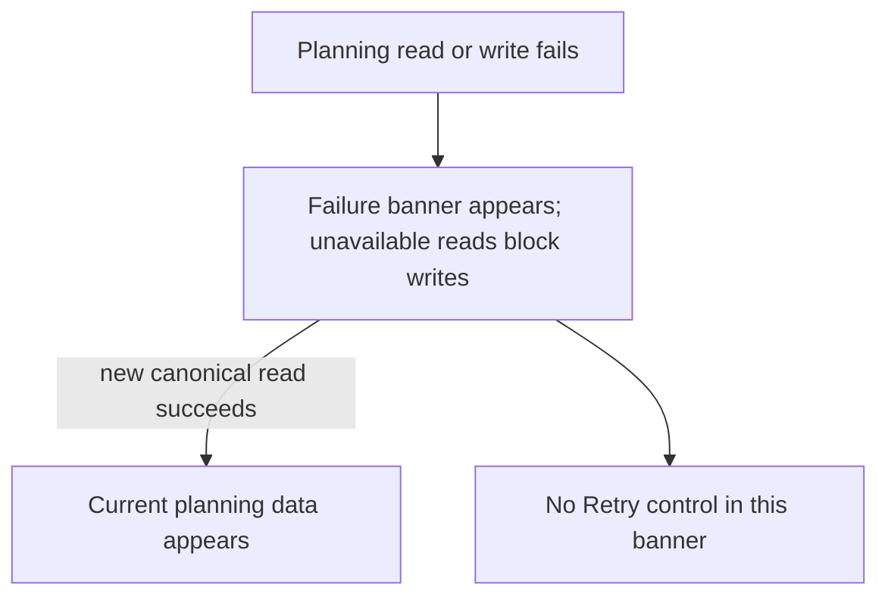
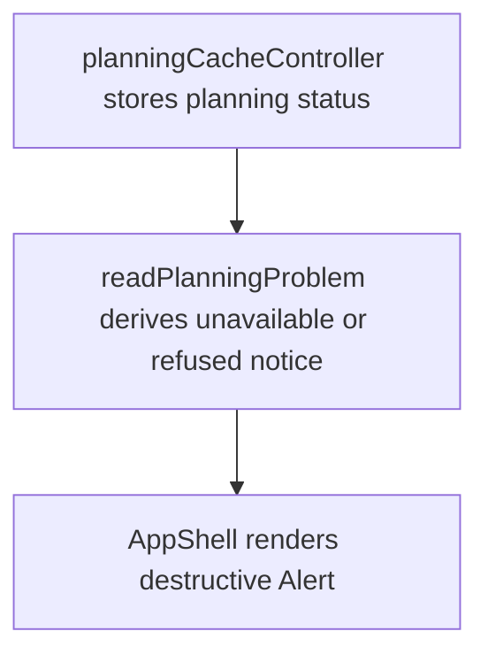

# US-NAV-04 — See planning read and save failures

As a company member, I want failed or uncertain server operations shown clearly so that I can make an informed recovery decision.

**Status:** Current

**Access:** Owner, Admin, Editor, Viewer

**Entry:** Schedule planning read/write failure → visible error notice

**Documentation:** [Incidents](../../docs-src/self-hosting/incidents.md)

**Source:** [AppShell.tsx](../../apps/frontend/src/components/AppShell.tsx); [planningCacheController.ts](../../apps/frontend/src/data/planning/planningCacheController.ts)

## Acceptance criteria

- A failed planning read shows an unavailable banner, blocks planning writes, and remains failed until a new canonical read succeeds. Failed or uncertain writes show a failure banner; planning-error banners provide no Retry control. The separate Connection failure screen has Retry (US-NAV-19).

## User flow

## Code flow

**Code references:** [planningCacheController.ts](../../apps/frontend/src/data/planning/planningCacheController.ts); [AppShell.tsx](../../apps/frontend/src/components/AppShell.tsx); [useStore.ts](../../apps/frontend/src/store/useStore.ts)
