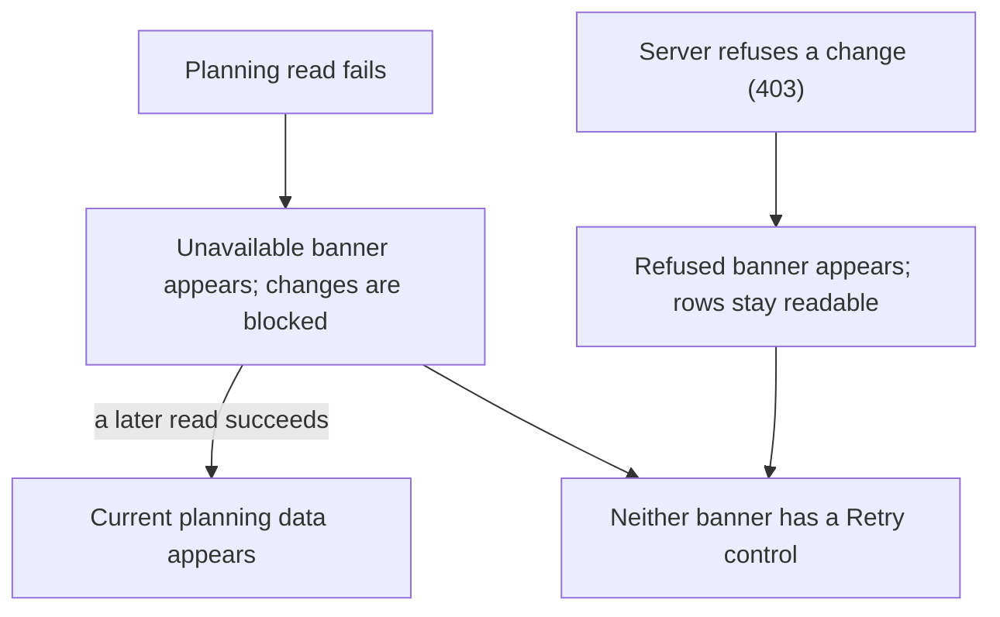
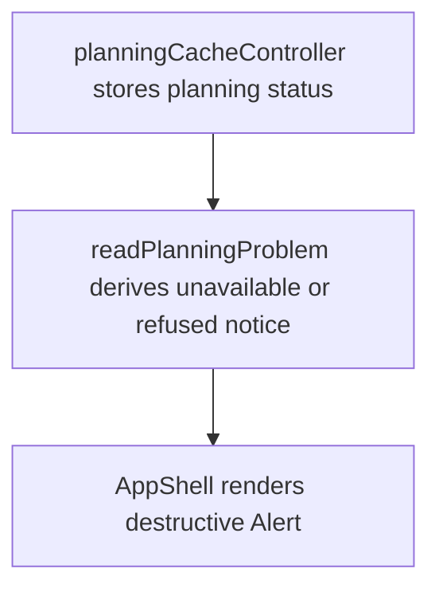

# US-NAV-04 — See planning read and save failures

As a company member, I want failed or uncertain server operations shown clearly so that I can make an informed recovery decision.

**Status:** Current

**Access:** Owner, Admin, Editor, Viewer

**Entry:** Schedule planning read/write failure → visible error notice

**Documentation:** [Incidents](../../docs-src/self-hosting/incidents.md)

**Source:** [AppShell.tsx](../../apps/frontend/src/components/AppShell.tsx); [planningCacheController.ts](../../apps/frontend/src/data/planning/planningCacheController.ts)

## Acceptance criteria

- A failed planning read shows **The schedule couldn’t be loaded from the server. Reload to try again.**, blocks planning changes and stays until a later read succeeds.
- A change the server refuses with 403 shows **That schedule change was refused, so it wasn’t saved.**; the loaded rows stay readable.
- While an earlier change’s outcome is still unconfirmed, further changes are refused. Neither banner has a Retry control.

## User flow

## Code flow

**Code references:** [planningCacheController.ts](../../apps/frontend/src/data/planning/planningCacheController.ts); [AppShell.tsx](../../apps/frontend/src/components/AppShell.tsx); [useStore.ts](../../apps/frontend/src/store/useStore.ts)
