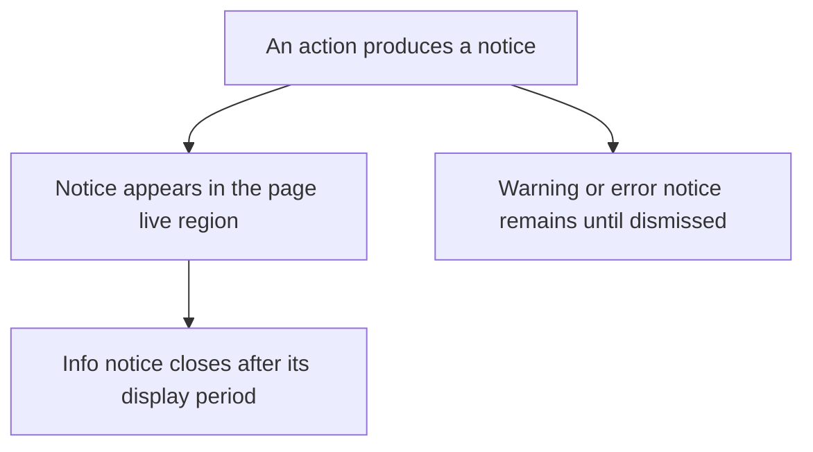
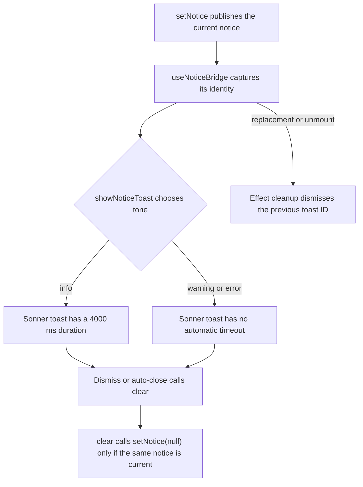

# US-NAV-05 — Read and dismiss action notices

As a company member, I want action feedback announced without blocking the page so that I can understand the result and continue.

**Status:** Current

**Access:** Owner, Admin, Editor, Viewer

**Entry:** Application live notice; Close toast button when present

**Documentation:** [Help](../../docs-src/using/help.md)

**Source:** [useAppShellViewModel.ts](../../apps/frontend/src/components/useAppShellViewModel.ts); [AppShell.tsx](../../apps/frontend/src/components/AppShell.tsx)

## Acceptance criteria

- Notices appear at the bottom centre and are announced in a polite live region. Informational notices close after 4 seconds; warnings and errors stay until closed with **Close toast**.

## User flow

## Code flow

**Code references:** [runtimeSlice.ts:99](../../apps/frontend/src/store/slices/runtimeSlice.ts#L99) · [shellNotices.ts:10](../../apps/frontend/src/components/app-shell/shellNotices.ts#L10) · [shellNotices.ts:21](../../apps/frontend/src/components/app-shell/shellNotices.ts#L21) · [AppShell.tsx:49](../../apps/frontend/src/components/AppShell.tsx#L49)
