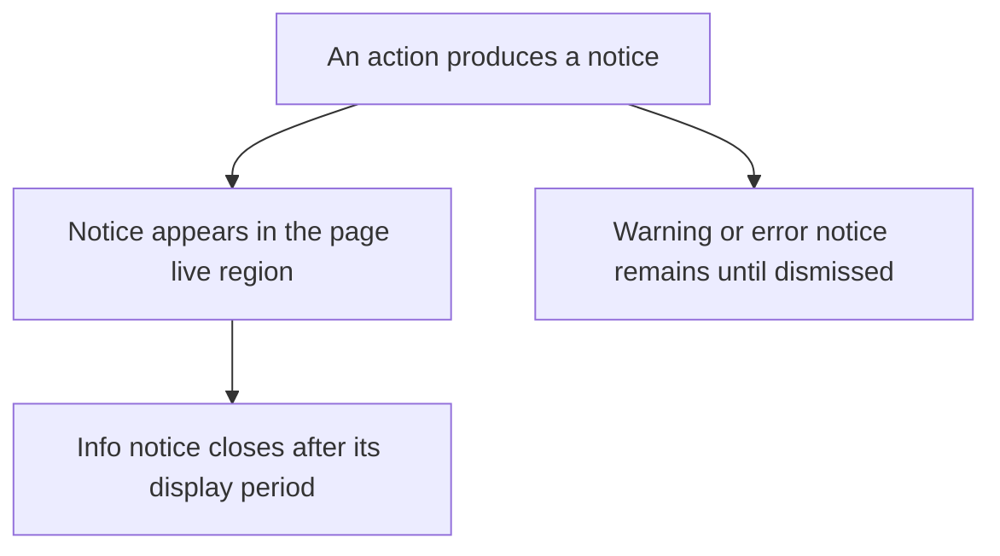
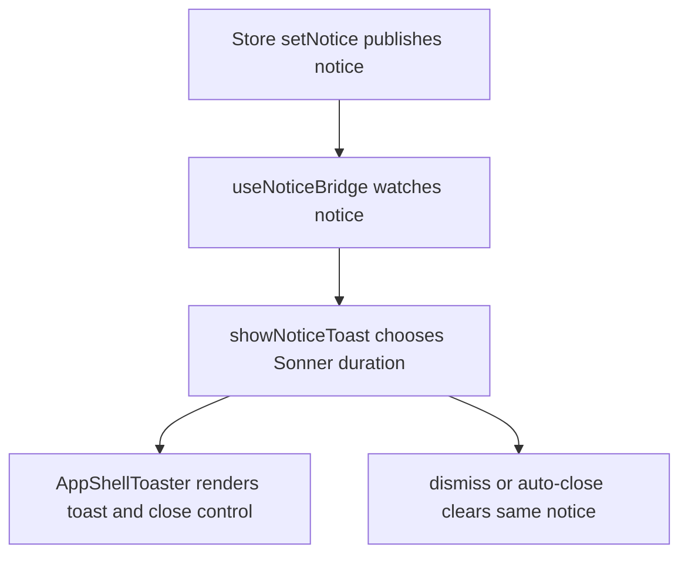

# US-NAV-05 — Read and dismiss action notices

As a company member, I want action feedback announced without blocking the page so that I can understand the result and continue.

**Status:** Current

**Access:** Owner, Admin, Editor, Viewer

**Entry:** Application live notice; Close toast button when present

**Documentation:** [Help](../../docs-src/using/help.md)

**Source:** [useAppShellController.ts](../../apps/frontend/src/components/useAppShellController.ts); [AppShell.tsx](../../apps/frontend/src/components/AppShell.tsx)

## Acceptance criteria

- Notices are announced in a polite live region; informational notices clear automatically and errors remain until dismissed.

## User flow

## Code flow

**Code references:** [useAppShellController.ts](../../apps/frontend/src/components/useAppShellController.ts); [AppShell.tsx](../../apps/frontend/src/components/AppShell.tsx); [runtimeSlice.ts](../../apps/frontend/src/store/slices/runtimeSlice.ts)
