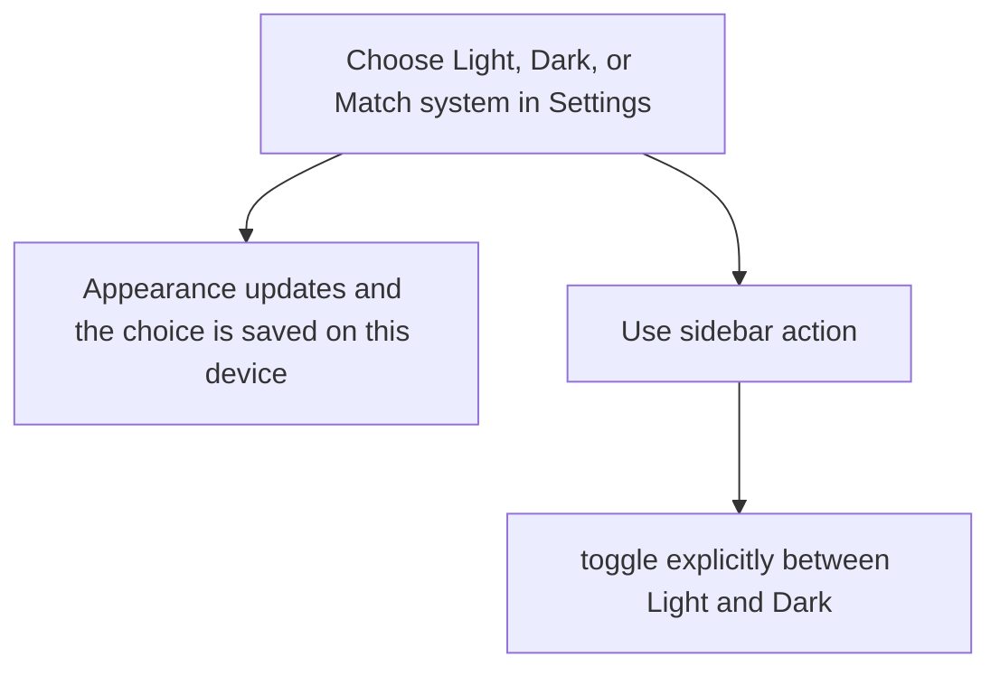
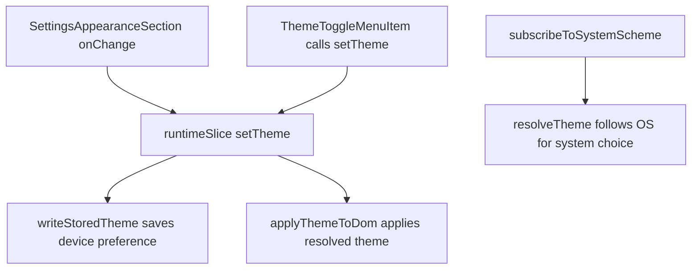

# US-NAV-06 — Choose appearance

As a company member, I want to choose this device’s light or dark appearance so that the interface suits my viewing conditions.

**Status:** Current

**Access:** Owner, Admin, Editor, Viewer

**Entry:** Sidebar theme action; Settings → My display

**Documentation:** [Settings](../../docs-src/using/settings.md)

**Source:** [AppSidebar.tsx](../../apps/frontend/src/components/AppSidebar.tsx); [theme.ts](../../apps/frontend/src/lib/theme.ts)

## Acceptance criteria

- Settings → My display → **Appearance on this device** offers **Light**, **Dark** and **Match system**. The sidebar action reads **Switch to light mode** or **Switch to dark mode** and switches between Light and Dark from the theme currently shown. The choice is a device preference.
- With the operating system’s reduced-motion setting, animations and transitions are effectively disabled.

## User flow

## Code flow

**Code references:** [SettingsAppearanceSection.tsx](../../apps/frontend/src/components/settings/SettingsAppearanceSection.tsx); [AppSidebar.tsx](../../apps/frontend/src/components/AppSidebar.tsx); [runtimeSlice.ts](../../apps/frontend/src/store/slices/runtimeSlice.ts); [theme.ts](../../apps/frontend/src/lib/theme.ts)
