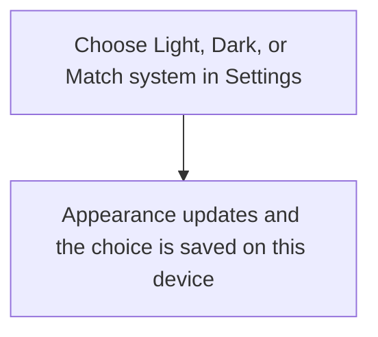
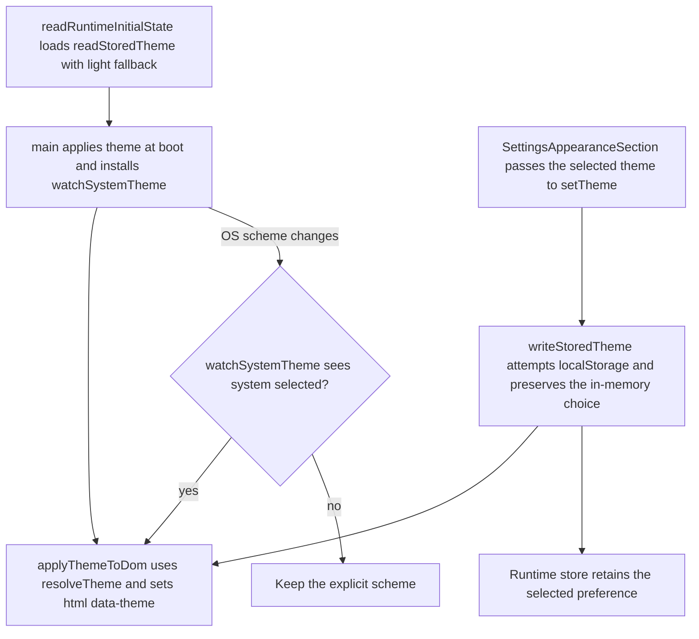

# US-NAV-06 — Choose appearance

As a company member, I want to choose this device’s light or dark appearance so that the interface suits my viewing conditions.

**Status:** Current

**Access:** Owner, Admin, Editor, Viewer

**Entry:** Settings → My display

**Documentation:** [Settings](../../docs-src/using/settings.md)

**Source:** [SettingsAppearanceSection.tsx](../../apps/frontend/src/components/settings/SettingsAppearanceSection.tsx); [theme.ts](../../apps/frontend/src/lib/theme.ts)

## Acceptance criteria

- Settings → My display → **Appearance on this device** offers **Light**, **Dark** and **Match system**. The sidebar has no theme action. The choice is a device preference.
- With the operating system’s reduced-motion setting, animations and transitions are effectively disabled.

## User flow

## Code flow

The CSS uses the resolved scheme. Reduced-motion CSS responds independently to the OS motion preference.

**Code references:** [SettingsAppearanceSection.tsx:55](../../apps/frontend/src/components/settings/SettingsAppearanceSection.tsx#L55) · [runtimeSlice.ts:72](../../apps/frontend/src/store/slices/runtimeSlice.ts#L72) · [runtimeSlice.ts:111](../../apps/frontend/src/store/slices/runtimeSlice.ts#L111) · [main.tsx:20](../../apps/frontend/src/main.tsx#L20) · [theme.ts:25](../../apps/frontend/src/lib/theme.ts#L25) · [theme.ts:49](../../apps/frontend/src/lib/theme.ts#L49)
