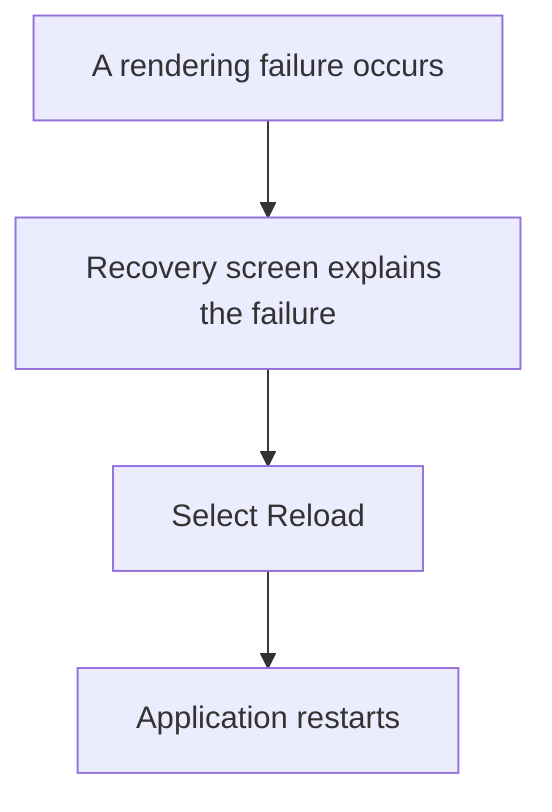
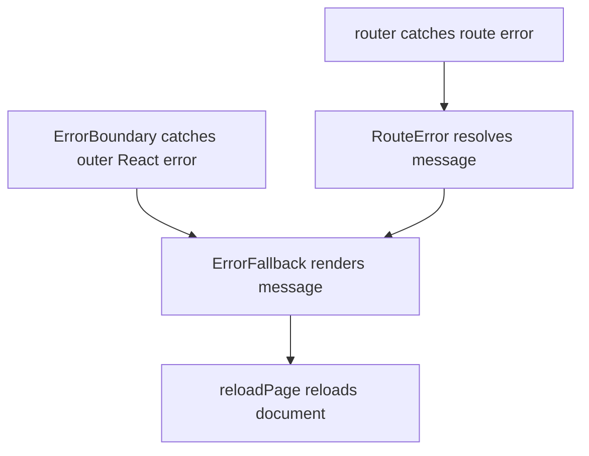

# US-NAV-07 — Recover from a rendering error

As a company member, I want a clear recovery action after an unexpected display failure so that I can reload the application.

**Status:** Current

**Access:** Owner, Admin, Editor, Viewer

**Entry:** Something went wrong screen → Reload

**Documentation:** [Faq](../../docs-src/using/faq.md)

**Source:** [ErrorBoundary.tsx](../../apps/frontend/src/components/common/ErrorBoundary.tsx)

## Acceptance criteria

- An uncaught rendering failure displays an error screen and Reload action instead of a blank page.

## User flow

## Code flow

**Code references:** [router.tsx](../../apps/frontend/src/router.tsx); [ErrorBoundary.tsx](../../apps/frontend/src/components/common/ErrorBoundary.tsx); [reloadPage.ts](../../apps/frontend/src/lib/reloadPage.ts)
