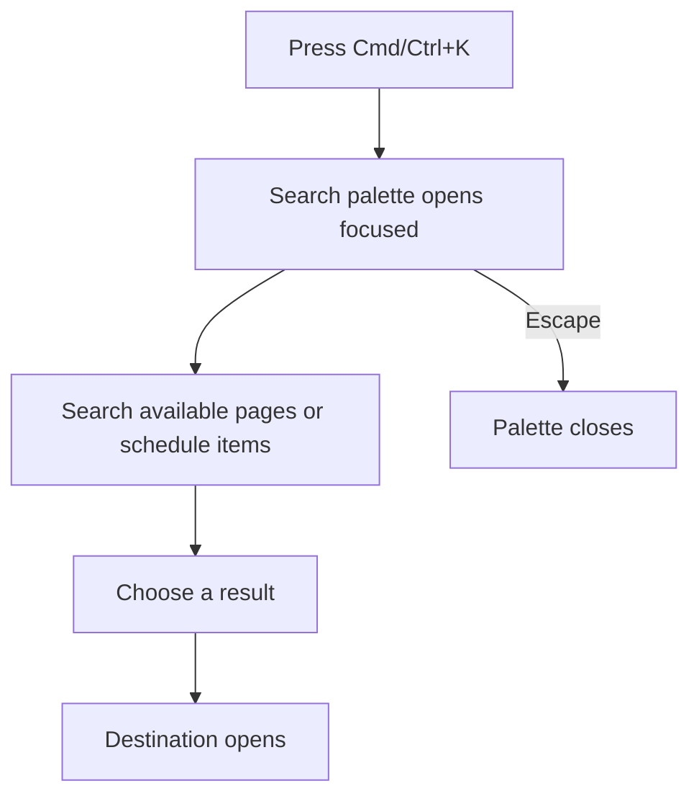
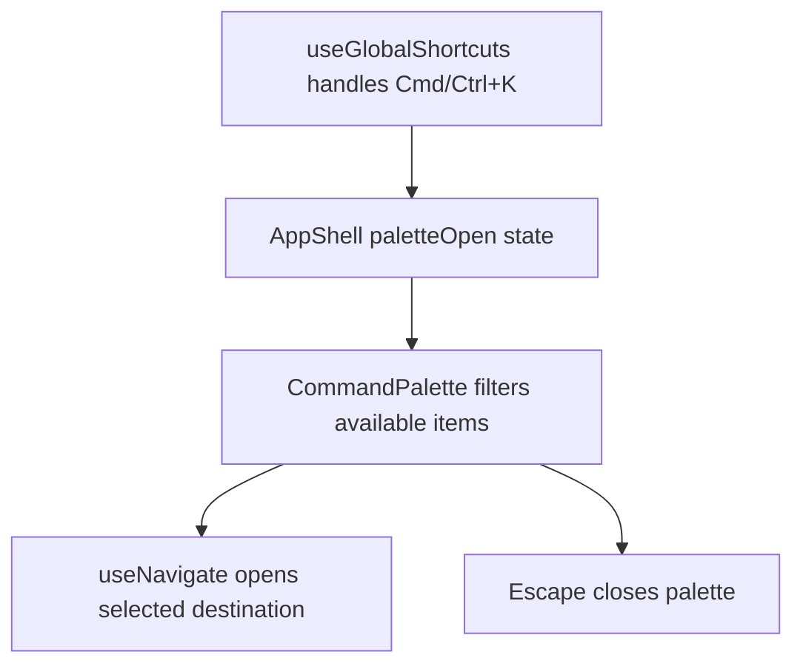

# US-NAV-08 — Jump with the command palette

As a company member, I want to search available pages and schedule destinations from the keyboard so that I can navigate quickly.

**Status:** Current

**Access:** Owner, Admin, Editor, Viewer; results respect destination access

**Entry:** ⌘K / Ctrl+K; palette search and result controls

**Documentation:** [Read The Schedule](../../docs-src/using/read-the-schedule.md)

**Source:** [CommandPalette.tsx](../../apps/frontend/src/components/CommandPalette.tsx)

## Acceptance criteria

- The palette opens focused, filters destinations and entities, and navigates only to available results.

## User flow

## Code flow

**Code references:** [useAppShellController.ts](../../apps/frontend/src/components/useAppShellController.ts); [AppShell.tsx](../../apps/frontend/src/components/AppShell.tsx); [CommandPalette.tsx](../../apps/frontend/src/components/CommandPalette.tsx)
