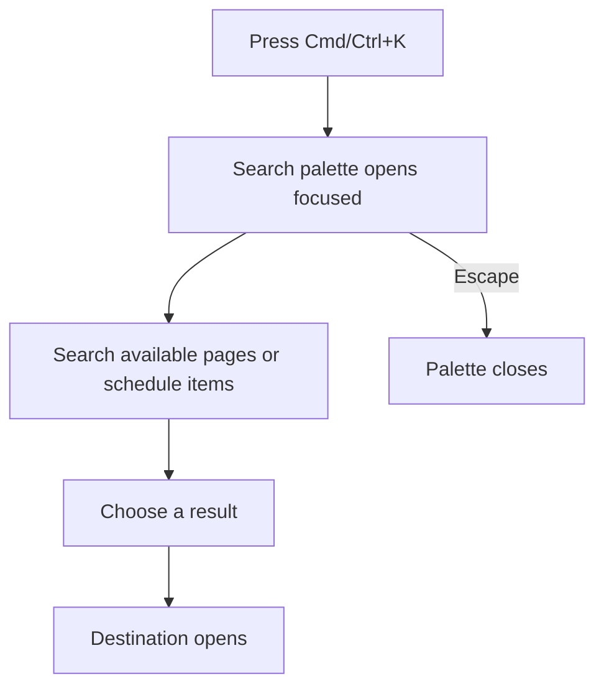
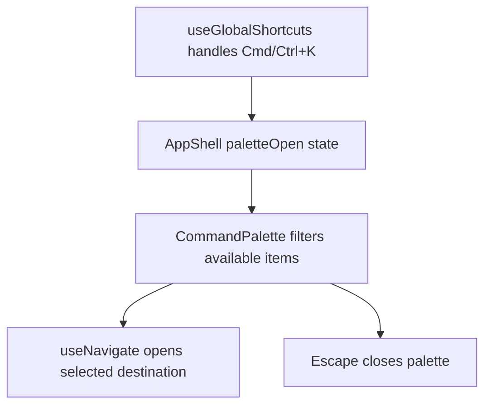

# US-NAV-08 — Jump with the command palette

As a company member, I want to search available pages and schedule destinations from the keyboard so that I can navigate quickly.

**Status:** Current

**Access:** Owner, Admin, Editor, Viewer; results respect destination access

**Entry:** ⌘K / Ctrl+K; palette search and result controls

**Documentation:** [Read The Schedule](../../docs-src/using/read-the-schedule.md)

**Source:** [CommandPalette.tsx](../../apps/frontend/src/components/CommandPalette.tsx)

## Acceptance criteria

- ⌘K / Ctrl+K opens or closes the palette with its search box focused. It does not open during IME composition or over another open dialog; with unsaved form changes it shows "You have unsaved changes — use Cancel or Save to close this dialog." instead.
- With no query, the palette lists **Go to today** and every page the role can open; Overview, Diagnostics and Disciplines appear only when available. Typing fuzzy-matches pages and active people, projects, clients and activities, up to five per section; a date typed as YYYY-MM-DD adds **Go to date {date}**. People exclude placeholders and external resources while those settings are off.
- Selecting a page opens it. A person opens the Schedule with filters cleared and scrolls to that row; a project or client opens the Schedule filtered to it; an activity opens Activities with it selected.

## User flow

## Code flow

**Code references:** [useAppShellController.ts](../../apps/frontend/src/components/useAppShellController.ts); [AppShell.tsx](../../apps/frontend/src/components/AppShell.tsx); [CommandPalette.tsx](../../apps/frontend/src/components/CommandPalette.tsx)
