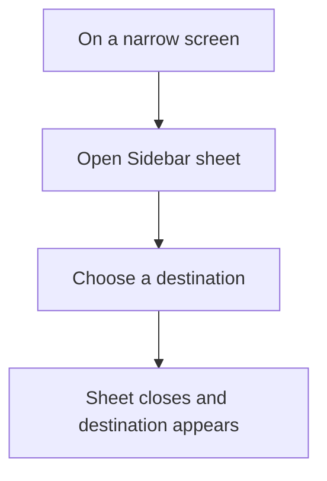
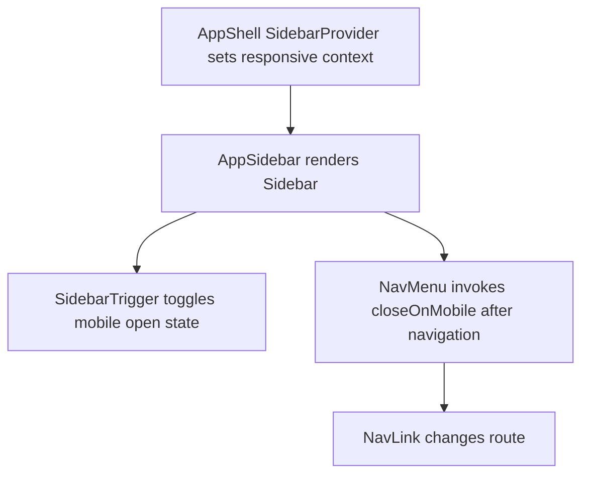

# US-NAV-09 — Use navigation on a narrow screen

As a company member viewing a narrow screen, I want compact navigation and a usable schedule view so that I can inspect information on that device.

**Status:** Current

**Access:** Owner, Admin, Editor, Viewer

**Entry:** Sidebar toggle; mobile Sidebar sheet

**Documentation:** [Read The Schedule](../../docs-src/using/read-the-schedule.md)

**Source:** [AppSidebar.tsx](../../apps/frontend/src/components/AppSidebar.tsx); [AppShell.tsx](../../apps/frontend/src/components/AppShell.tsx)

## Acceptance criteria

- Navigation opens as a labelled sheet on narrow portrait layouts and closes after destination selection; mobile scheduling workflows are out of scope.

## User flow

## Code flow

**Code references:** [AppShell.tsx](../../apps/frontend/src/components/AppShell.tsx); [AppSidebar.tsx](../../apps/frontend/src/components/AppSidebar.tsx); [sidebar.tsx](../../apps/frontend/src/components/ui/sidebar.tsx)
