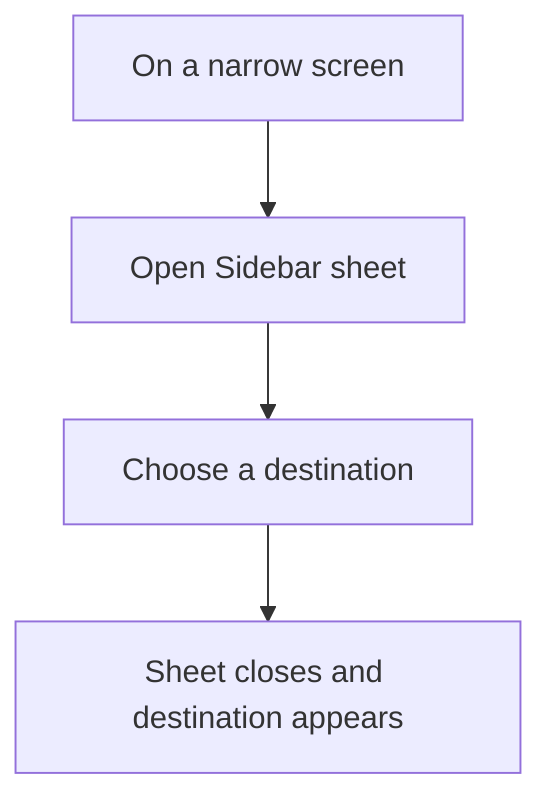
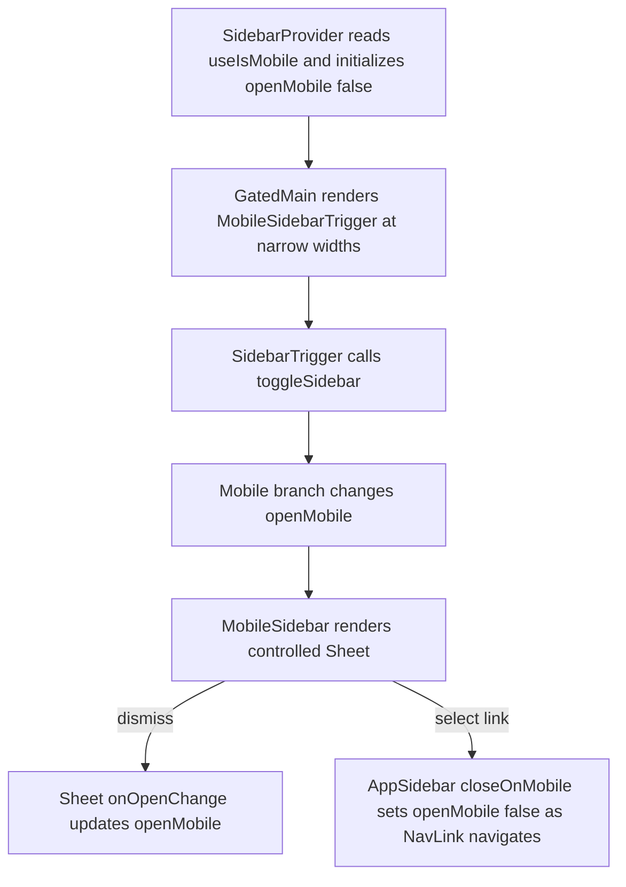

# US-NAV-09 — Use navigation on a narrow screen

As a company member viewing a narrow screen, I want compact navigation and a usable schedule view so that I can inspect information on that device.

**Status:** Current

**Access:** Owner, Admin, Editor, Viewer

**Entry:** Sidebar toggle; mobile Sidebar sheet

**Documentation:** [Read The Schedule](../../docs-src/using/read-the-schedule.md)

**Source:** [AppSidebar.tsx](../../apps/frontend/src/components/AppSidebar.tsx); [AppShell.tsx](../../apps/frontend/src/components/AppShell.tsx)

## Acceptance criteria

- At viewport widths up to 767 px, navigation opens as a labelled sheet from the top-bar sidebar toggle and closes after a destination is chosen; mobile scheduling workflows are out of scope.

## User flow

## Code flow

The desktop open preference is a separate path in [US-NAV-22](US-NAV-22-desktop-sidebar-toggle.md#code-flow).

**Code references:** [AppShell.tsx:27](../../apps/frontend/src/components/AppShell.tsx#L27) · [AppShell.tsx:165](../../apps/frontend/src/components/AppShell.tsx#L165) · [sidebar.tsx:73](../../apps/frontend/src/components/ui/sidebar.tsx#L73) · [sidebar.tsx:246](../../apps/frontend/src/components/ui/sidebar.tsx#L246) · [sidebar.tsx:371](../../apps/frontend/src/components/ui/sidebar.tsx#L371) · [AppSidebar.tsx:36](../../apps/frontend/src/components/AppSidebar.tsx#L36)
