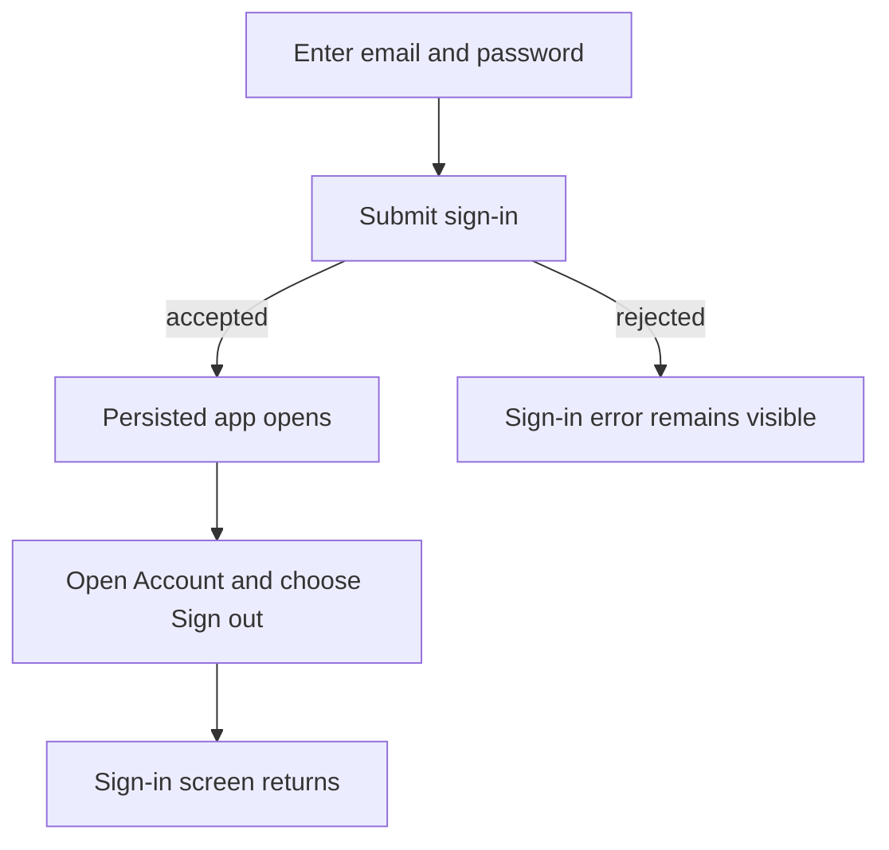
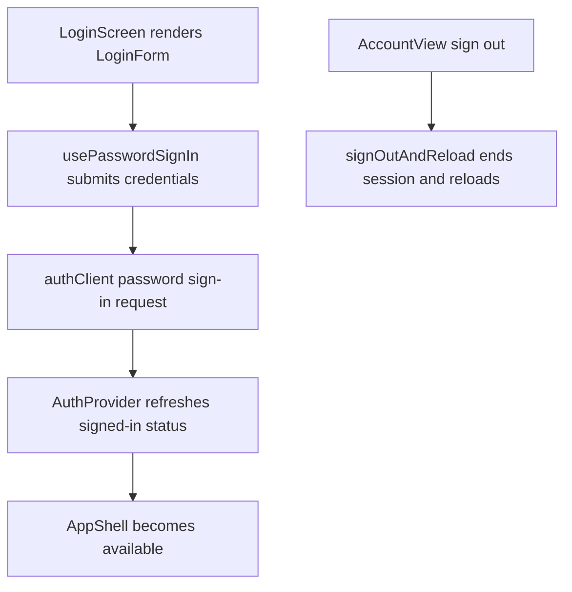

# US-NAV-10 — Enter the persisted application

As an invited company member, I want to sign in before accessing persisted company data so that my session is authenticated.

**Status:** Current

**Access:** Unauthenticated visitors; admitted users can sign in

**Entry:** Sign-in screen; Account → Sign out

**Documentation:** [Account](../../docs-src/using/account.md)

**Source:** [LoginScreen.tsx](../../apps/frontend/src/auth/LoginScreen.tsx); [AccountView.tsx](../../apps/frontend/src/components/account/AccountView.tsx)

## Acceptance criteria

| Field    | Control        | Required/default/conditions                                                                                        |
| -------- | -------------- | ------------------------------------------------------------------------------------------------------------------ |
| Email    | Email input    | Submitted for password sign-in; browser email autofill enabled                                                     |
| Password | Password input | Submitted for password sign-in; current-password autofill; overlong input is rejected and associated with an error |

- Sign in submits credentials; Account → Sign out ends the session and returns to sign-in. The disposable demo uses its printed development sign-in.

## User flow

## Code flow

**Code references:** [usePasswordSignIn.ts](../../apps/frontend/src/auth/usePasswordSignIn.ts); [LoginScreen.tsx](../../apps/frontend/src/auth/LoginScreen.tsx); [LoginForm.tsx](../../apps/frontend/src/auth/LoginForm.tsx); [authClient.ts](../../apps/frontend/src/auth/authClient.ts); [AuthProvider.tsx](../../apps/frontend/src/auth/AuthProvider.tsx); [AccountView.tsx](../../apps/frontend/src/components/account/AccountView.tsx); [signOut.ts](../../apps/frontend/src/auth/signOut.ts)
