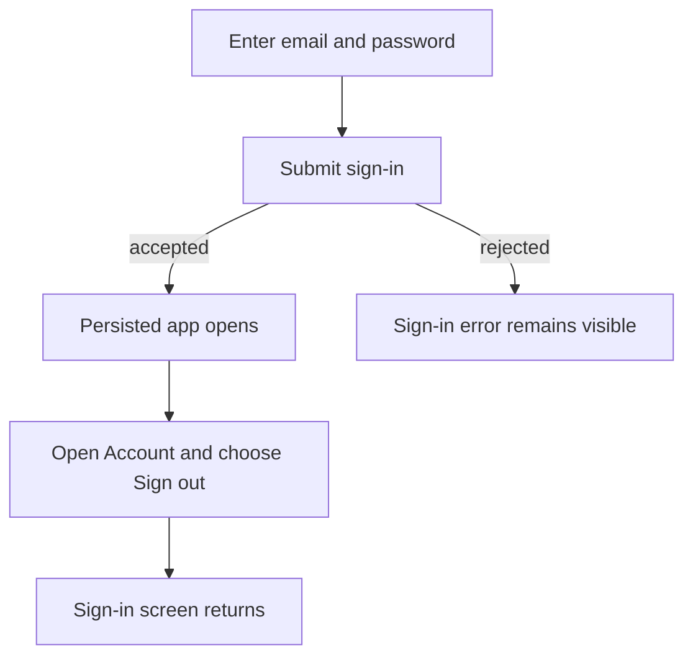
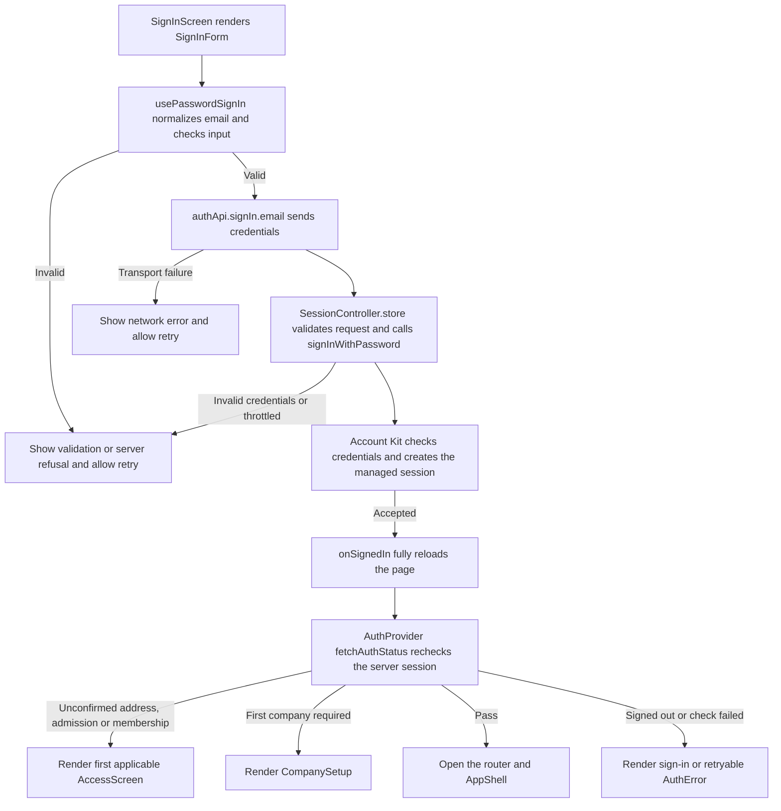

# US-NAV-10 — Enter the persisted application

As an invited company member, I want to sign in before accessing persisted company data so that my session is authenticated.

**Status:** Current

**Access:** Unauthenticated visitors; admitted users can sign in

**Entry:** Sign-in screen; Account → Sign out

**Documentation:** [Account](../../docs-src/using/account.md)

**Source:** [SignInScreen.tsx](../../apps/frontend/src/auth/SignInScreen.tsx); [AccountView.tsx](../../apps/frontend/src/components/account/AccountView.tsx)

## Acceptance criteria

| Field    | Control        | Required/default/conditions                                                                                        |
| -------- | -------------- | ------------------------------------------------------------------------------------------------------------------ |
| Email    | Email input    | Submitted for password sign-in; browser email autofill enabled                                                     |
| Password | Password input | Submitted for password sign-in; current-password autofill; overlong input is rejected and associated with an error |

- Sign in submits credentials; Account → Sign out ends the session and returns to sign-in. The disposable demo uses its printed development sign-in.

## User flow

## Code flow

**Code references:** [SignInForm.tsx](../../apps/frontend/src/auth/SignInForm.tsx#L46) · [usePasswordSignIn.ts](../../apps/frontend/src/auth/usePasswordSignIn.ts#L9) · [session_controller.ts](../../apps/backend/app/controllers/session_controller.ts#L60) · [password_sign_in.ts](../../apps/backend/app/services/auth/password_sign_in.ts#L34) · [AuthProvider.tsx](../../apps/frontend/src/auth/AuthProvider.tsx#L152) · [AuthProvider.tsx](../../apps/frontend/src/auth/AuthProvider.tsx#L250) · [password_sessions.spec.ts](../../apps/backend/tests/functional/auth/password_sessions.spec.ts#L118)
