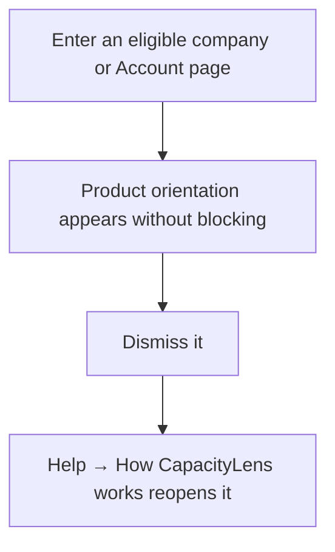
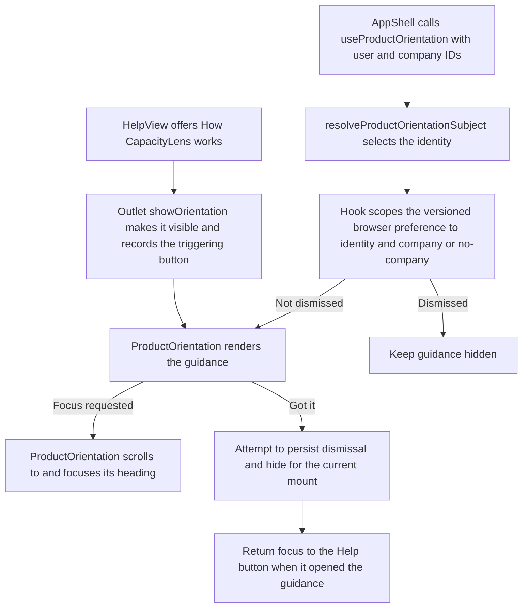

# US-NAV-12 — Understand the product at entry

As a company member, I want concise product guidance when I enter so that I can understand the schedule without being blocked.

**Status:** Current

**Access:** Owner, Admin, Editor, Viewer

**Entry:** Automatically shown orientation; Help → How CapacityLens works

**Documentation:** [What Is Capacitylens](../../docs-src/getting-started/what-is-capacitylens.md)

**Source:** [ProductOrientation.tsx](../../apps/frontend/src/components/ProductOrientation.tsx); [useProductOrientation.ts](../../apps/frontend/src/components/useProductOrientation.ts); [HelpView.tsx](../../apps/frontend/src/components/HelpView.tsx)

## Acceptance criteria

- Eligible users see non-blocking guidance until dismissed; dismissal is a scoped device preference and the **How CapacityLens works** button on Help reopens it.

## User flow

## Code flow

**Code references:** [AppShell.tsx](../../apps/frontend/src/components/AppShell.tsx#L95) · [AppShell.tsx](../../apps/frontend/src/components/AppShell.tsx#L218) · [useProductOrientation.ts](../../apps/frontend/src/components/useProductOrientation.ts#L10) · [ProductOrientation.tsx](../../apps/frontend/src/components/ProductOrientation.tsx#L17) · [HelpView.tsx](../../apps/frontend/src/components/HelpView.tsx#L34) · [productOrientation.ts](../../apps/frontend/src/lib/productOrientation.ts#L9) · [AppShell.productOrientation.test.tsx](../../apps/frontend/src/components/AppShell.productOrientation.test.tsx#L118) · [AppShell.productOrientation.test.tsx](../../apps/frontend/src/components/AppShell.productOrientation.test.tsx#L146)
