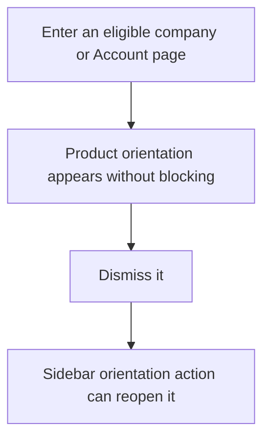
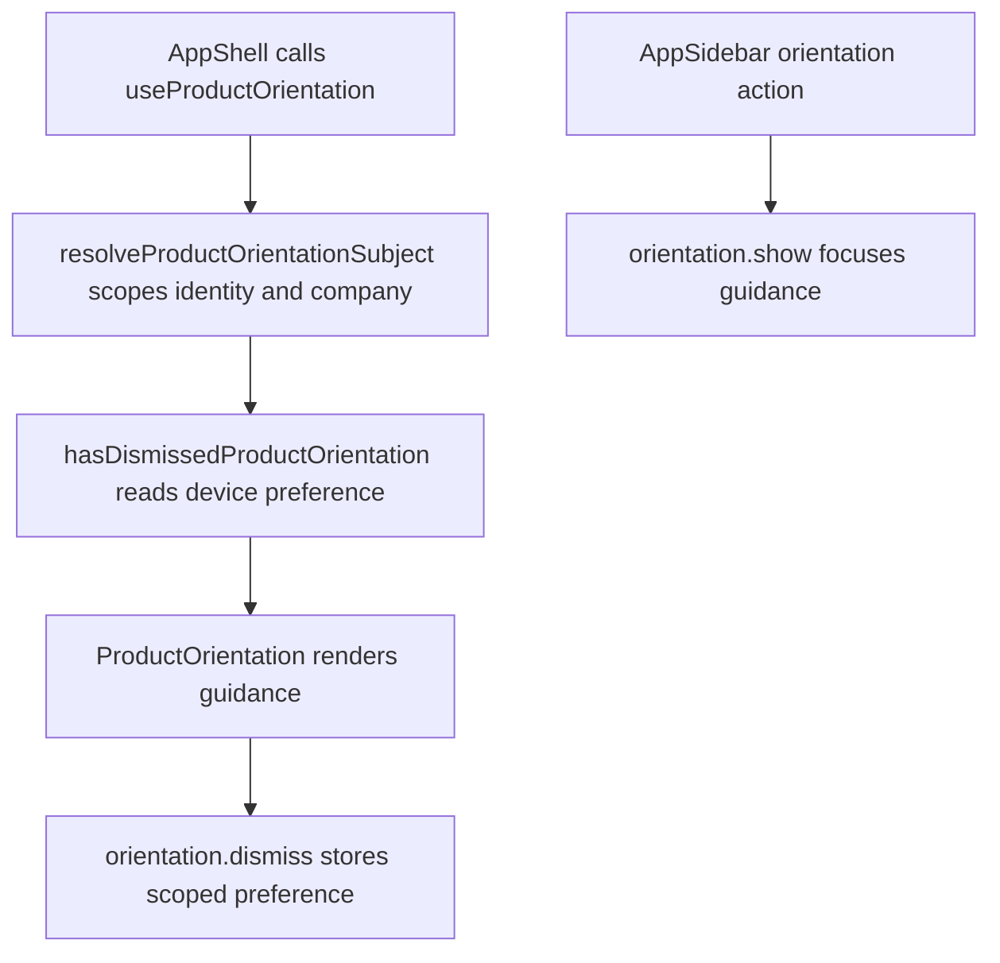

# US-NAV-12 — Understand the product at entry

As a company member, I want concise product guidance when I enter so that I can understand the schedule without being blocked.

**Status:** Current

**Access:** Owner, Admin, Editor, Viewer

**Entry:** Automatically shown orientation; sidebar product-orientation action

**Documentation:** [What Is Capacitylens](../../docs-src/getting-started/what-is-capacitylens.md)

**Source:** [ProductOrientation.tsx](../../apps/frontend/src/components/ProductOrientation.tsx); [useProductOrientation.ts](../../apps/frontend/src/components/useProductOrientation.ts)

## Acceptance criteria

- Eligible users see non-blocking guidance until dismissed; dismissal is a scoped device preference and the sidebar action reopens it.

## User flow

## Code flow

**Code references:** [AppShell.tsx](../../apps/frontend/src/components/AppShell.tsx); [useProductOrientation.ts](../../apps/frontend/src/components/useProductOrientation.ts); [ProductOrientation.tsx](../../apps/frontend/src/components/ProductOrientation.tsx); [productOrientation.ts](../../apps/frontend/src/lib/productOrientation.ts); [AppSidebar.tsx](../../apps/frontend/src/components/AppSidebar.tsx)
