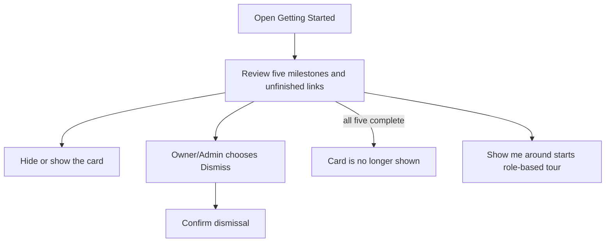
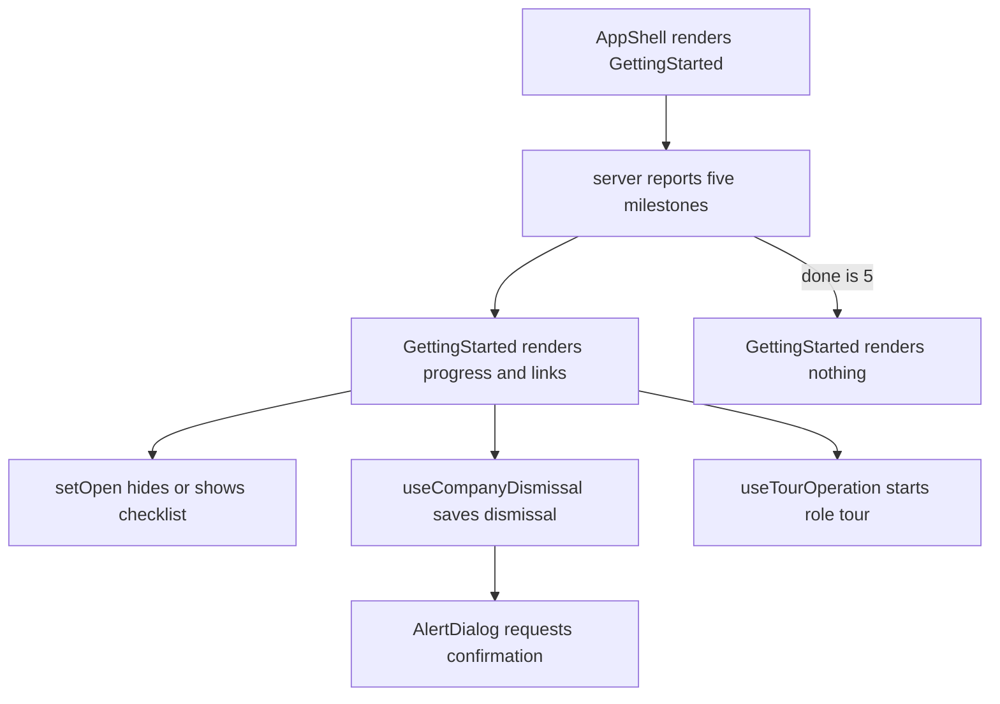

# US-NAV-13 — Track first schedule progress

As an Owner, Admin, or Editor, I want visible first-schedule milestones so that I can prepare useful company planning data.

**Status:** Current

**Access:** Owner, Admin, Editor; Viewer does not see the Getting Started panel

**Entry:** Getting Started panel and its milestone links

**Documentation:** [Quick Start](../../docs-src/getting-started/quick-start.md)

**Source:** [GettingStarted.tsx](../../apps/frontend/src/components/GettingStarted.tsx)

## Acceptance criteria

- Five milestones reflect current company data. Each unfinished milestone links to its relevant screen; completed milestones are shown as done.
- **Hide checklist** and **Show checklist** collapse and expand the card. Owners and Admins see **Dismiss**, which hides the card for everyone in the company; it always first asks **Do you really want to hide this forever?** (**Yes** / **No**). Once all five milestones are complete the card is not shown on any page; it returns if a completed milestone is undone. Editors can use the card but have no **Dismiss**.
- Show me around starts the role-aware schedule tour when available. The Help page provides a separate, persistent route to start that tour.

## User flow

## Code flow

**Code references:** [AppShell.tsx](../../apps/frontend/src/components/AppShell.tsx); [GettingStarted.tsx](../../apps/frontend/src/components/GettingStarted.tsx); [getting_started.ts](../../apps/backend/app/services/getting_started.ts); [gettingStartedApi.ts](../../apps/frontend/src/account/gettingStartedApi.ts); [useTourOperation.ts](../../apps/frontend/src/hooks/useTourOperation.ts)
