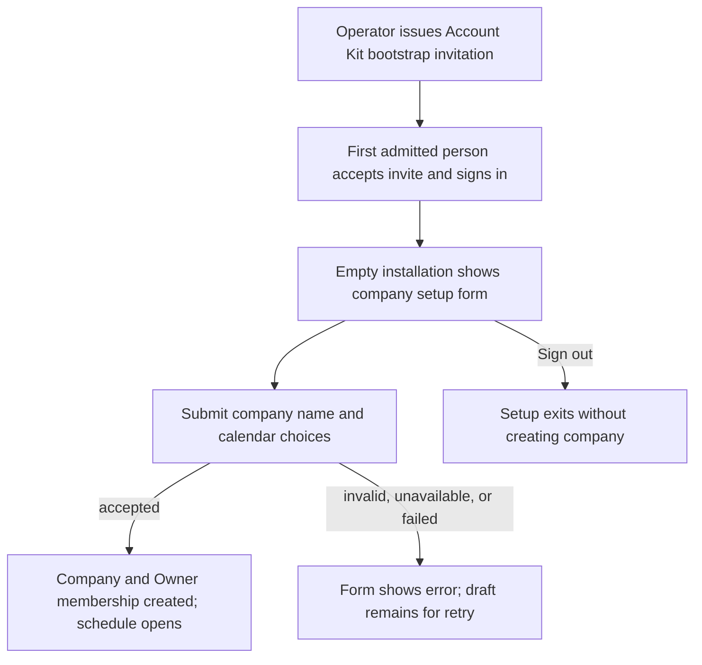
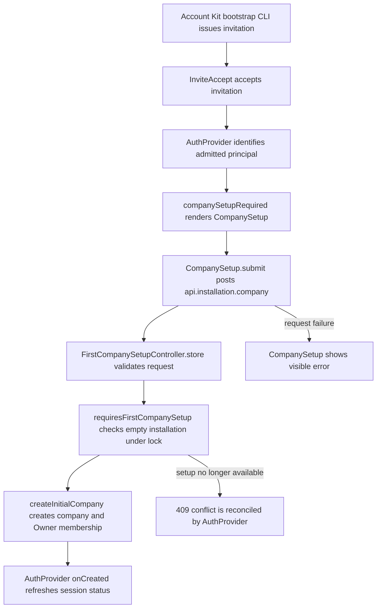

# US-NAV-14 — Set up and open the installation company

As an initial admitted person, I want to initialize the empty installation’s company so that the company can begin planning.

**Status:** Current

**Access:** Initial admitted identity only during empty-install setup; subsequent entry requires membership

**Documentation:** [Create Your Company](../../docs-src/owner/create-your-company.md)

**Entry:** Set up your company on an empty installation

**Source:** [CompanySetup.tsx](../../apps/frontend/src/auth/CompanySetup.tsx)

## Acceptance criteria

| Field          | Control    | Required/default/conditions                               |
| -------------- | ---------- | --------------------------------------------------------- |
| Company name   | Text input | Required; valid supported name; disabled while submitting |
| Week starts on | Select     | Defaults to Monday; Monday or Sunday                      |
| Timezone       | Select     | Defaults to `Etc/GMT`; supported time zones only          |

- Create company submits setup; Sign out ends setup without creating a company. Success opens the installation company; a failed request remains visible for retry.

## User flow

## Code flow

**Code references:** [AuthProvider.tsx](../../apps/frontend/src/auth/AuthProvider.tsx); [InviteAccept.tsx](../../apps/frontend/src/components/invites/InviteAccept.tsx); [CompanySetup.tsx](../../apps/frontend/src/auth/CompanySetup.tsx); [authClient.ts](../../apps/frontend/src/auth/authClient.ts); [company_routes.ts](../../apps/backend/start/company_routes.ts); [first_company_setup_controller.ts](../../apps/backend/app/controllers/first_company_setup_controller.ts); [first_company_setup.ts](../../apps/backend/app/services/first_company_setup.ts); [initial_company_defaults.ts](../../apps/backend/app/services/initial_company_defaults.ts); [install.md](../../docs-src/self-hosting/install.md)
