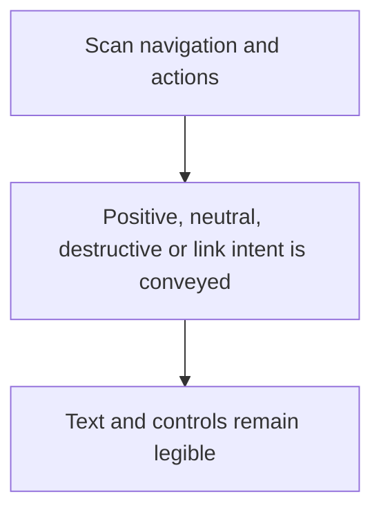
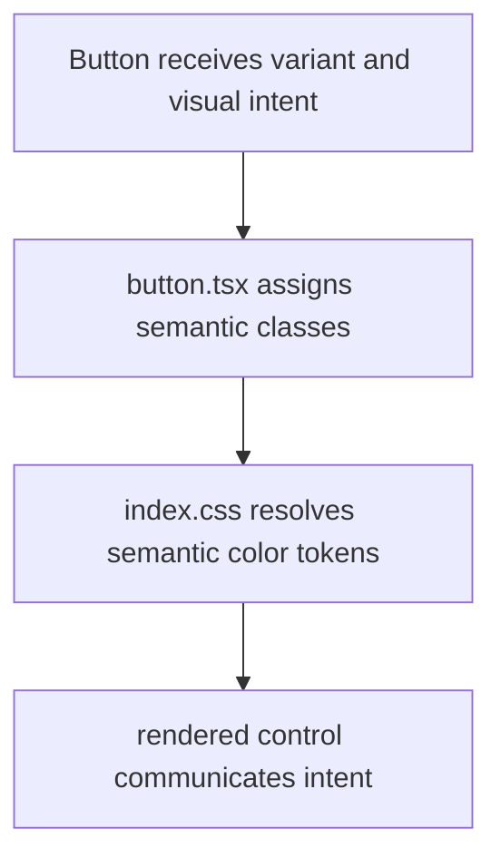

# US-NAV-15 — Recognize action meaning and product identity

As a company member, I want consistent semantic colours so that I can recognize product, positive, and destructive actions.

**Status:** Current

**Access:** Owner, Admin, Editor, Viewer

**Entry:** Navigation and action buttons

**Documentation:** [Help](../../docs-src/using/help.md)

**Source:** [AppSidebar.tsx](../../apps/frontend/src/components/AppSidebar.tsx); [button.tsx](../../apps/frontend/src/components/ui/button.tsx)

## Acceptance criteria

- Buttons share one semantic variant set: green for primary and confirming actions; neutral outline, secondary or ghost styles for secondary and cancel actions; red destructive or soft-danger styles for destructive actions; and the brand colour for link-styled actions.

## User flow

## Code flow

**Code references:** [button.tsx](../../apps/frontend/src/components/ui/button.tsx); [index.css](../../apps/frontend/src/index.css)
