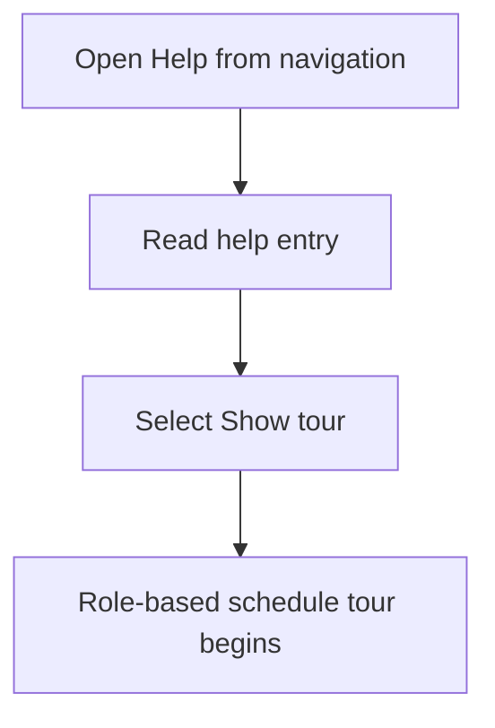
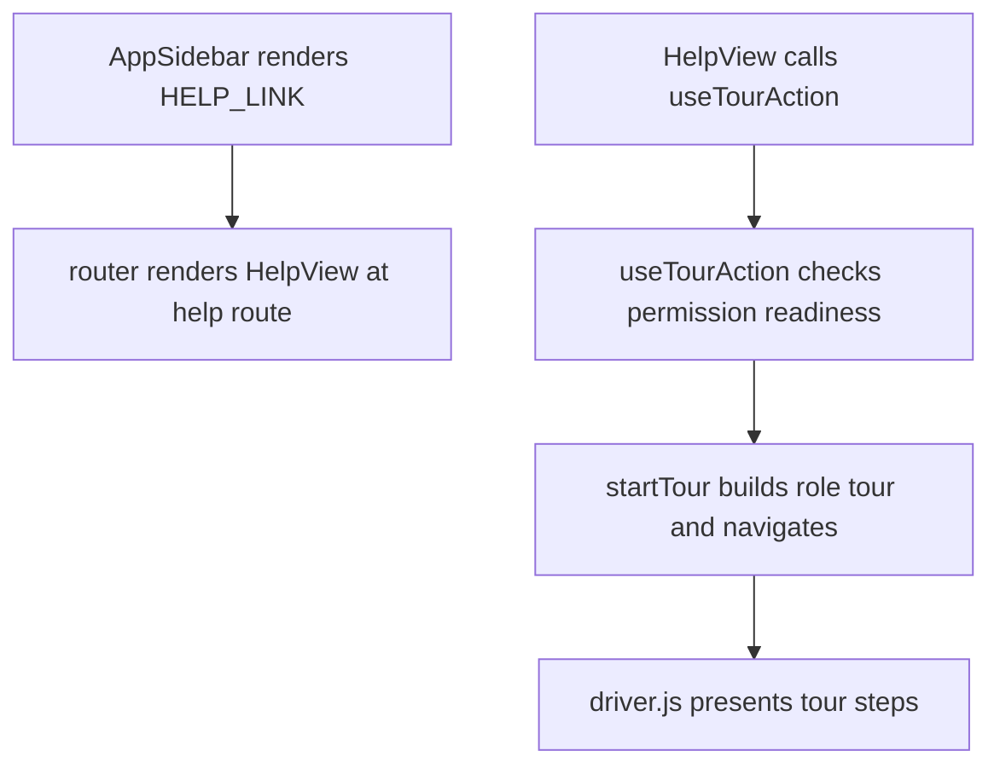

# US-NAV-16 — Find help and a role-based tour

As a company member, I want help and guidance suited to my role so that I can learn relevant controls.

**Status:** Current

**Access:** Owner, Admin, Editor, Viewer

**Entry:** Help sidebar link; Help view tour control

**Documentation:** [Help](../../docs-src/using/help.md); [Roles And Permissions](../../docs-src/getting-started/roles-and-permissions.md)

**Source:** [HelpView.tsx](../../apps/frontend/src/components/HelpView.tsx); [AppSidebar.tsx](../../apps/frontend/src/components/AppSidebar.tsx)

## Acceptance criteria

- The sidebar **Help** link opens Help, which offers **Show tour** and a **Browse the user guides** link. **Show tour** opens the Schedule and steps through guidance for the active role; it is disabled until the role is known.

## User flow

## Code flow

**Code references:** [AppSidebar.tsx](../../apps/frontend/src/components/AppSidebar.tsx); [navLinks.ts](../../apps/frontend/src/lib/navLinks.ts); [router.tsx](../../apps/frontend/src/router.tsx); [HelpView.tsx](../../apps/frontend/src/components/HelpView.tsx); [useTourAction.ts](../../apps/frontend/src/hooks/useTourAction.ts); [tour.ts](../../apps/frontend/src/lib/tour.ts); [tourSteps.ts](../../apps/frontend/src/lib/tourSteps.ts)
