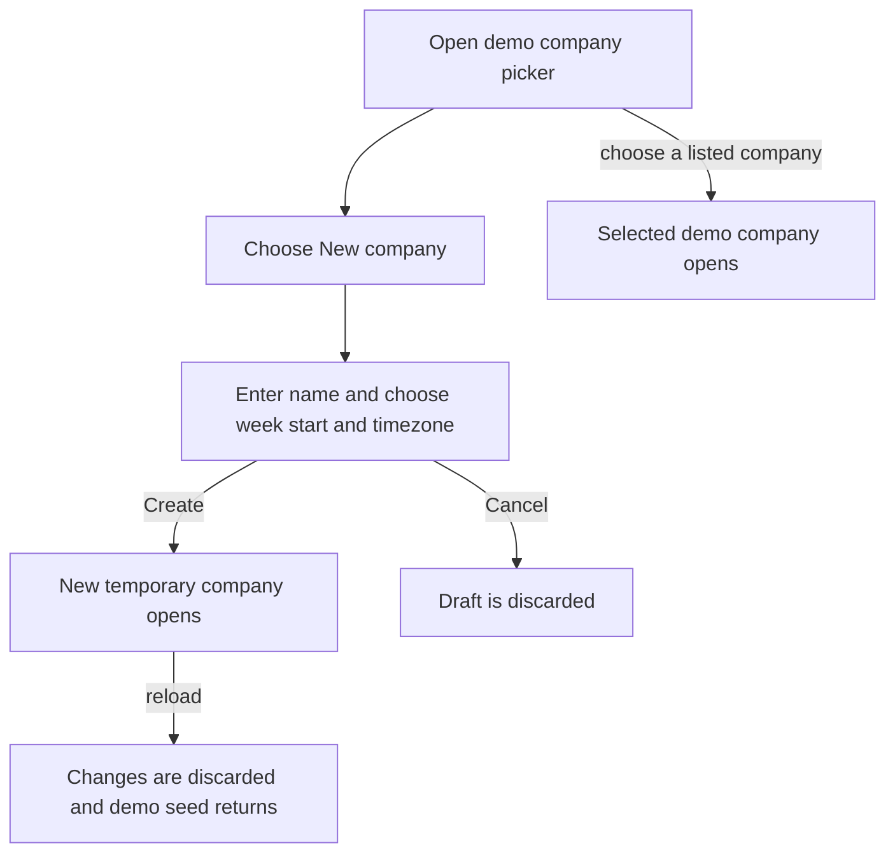
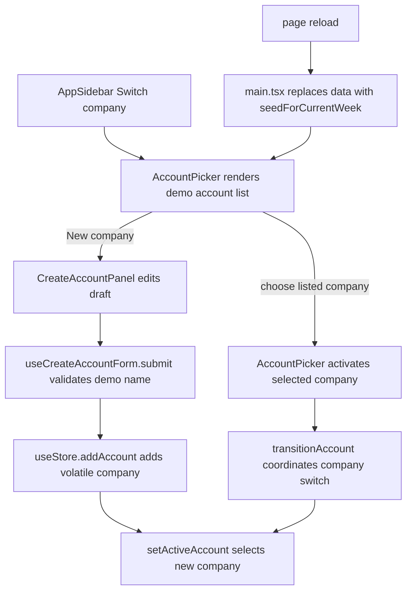

# US-NAV-17 — Create, switch between, and reset demo companies

As a prospective user, I want to create and switch between temporary sample companies so that I can explore CapacityLens without setting up a persisted installation.

**Status:** Demo

Demo companies are in-memory and changes reset on reload.

**Access:** Anyone using the demo build; no account role applies.

**Entry:** Demo application → company picker → New company; sidebar → Switch company.

**Documentation:** [Quick start](../../docs-src/getting-started/quick-start.md)

**Source:** [AccountPicker.tsx](../../apps/frontend/src/components/accounts/AccountPicker.tsx); [CreateAccountPanel.tsx](../../apps/frontend/src/components/accounts/CreateAccountPanel.tsx); [useCreateAccountForm.ts](../../apps/frontend/src/components/accounts/useCreateAccountForm.ts); [AppSidebar.tsx](../../apps/frontend/src/components/AppSidebar.tsx)

## Acceptance criteria

| Field          | Control           | Required/default/conditions                   |
| -------------- | ----------------- | --------------------------------------------- |
| Company name   | Text input        | Required; validated name                      |
| Week starts on | Segmented control | Defaults to Monday; Monday or Sunday          |
| Timezone       | Select            | Defaults to browser timezone; supported zones |
| Language       | Disabled display  | English; fixed                                |

- New company creates a temporary company and opens it; Cancel discards the draft. The picker lists demo companies for switching, and the sidebar offers Switch company. Reload discards demo changes and returns to the seeded demo state.

## User flow

## Code flow

**Code references:** [accountSlice.ts](../../apps/frontend/src/store/slices/accountSlice.ts); [accountTransition.ts](../../apps/frontend/src/auth/accountTransition.ts); [main.tsx](../../apps/frontend/src/main.tsx); [AccountPicker.tsx](../../apps/frontend/src/components/accounts/AccountPicker.tsx); [CreateAccountPanel.tsx](../../apps/frontend/src/components/accounts/CreateAccountPanel.tsx); [useCreateAccountForm.ts](../../apps/frontend/src/components/accounts/useCreateAccountForm.ts); [useStore.ts](../../apps/frontend/src/store/useStore.ts); [AppSidebar.tsx](../../apps/frontend/src/components/AppSidebar.tsx); [apiConfig.ts](../../apps/frontend/src/data/apiConfig.ts)
