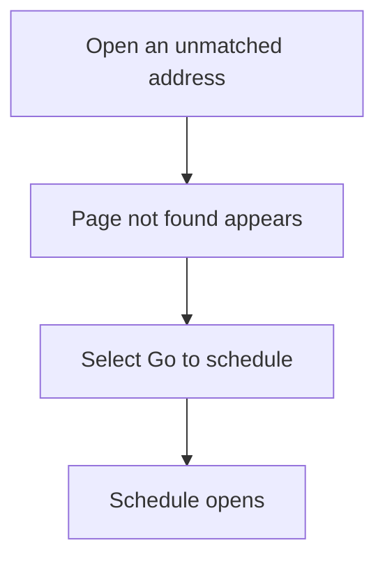
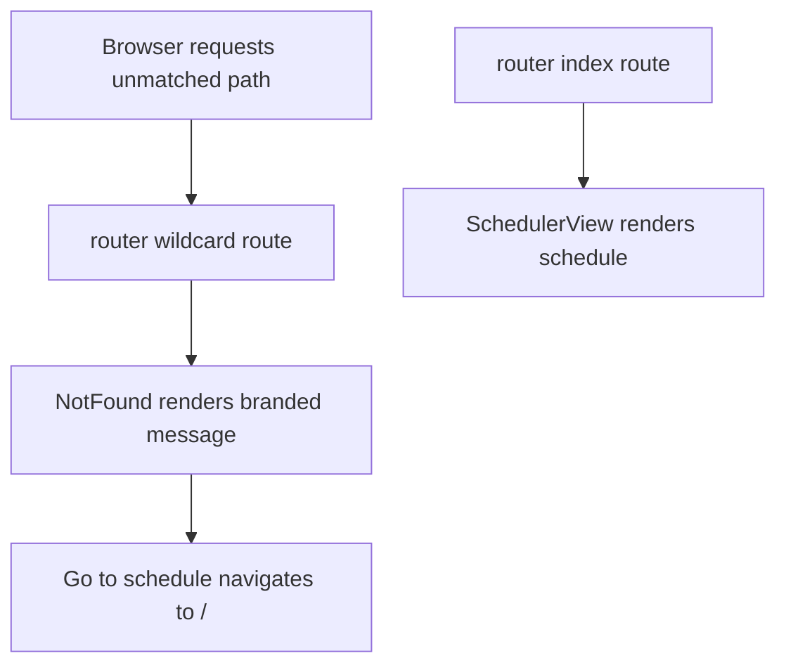

# US-NAV-18 — Recover from an unmatched address

As a company member, I want an unmatched address to explain that the page was not found and offer a route back so that I can resume navigation.

**Status:** Current

**Access:** Owner, Admin, Editor, Viewer; sign-in wall still applies to protected routes.

**Entry:** Unmatched extensionless URL → Page not found → Go to schedule.

**Documentation:** [FAQ](../../docs-src/using/faq.md)

**Source:** [router.tsx](../../apps/frontend/src/router.tsx); [NotFound.tsx](../../apps/frontend/src/components/common/NotFound.tsx)

## Acceptance criteria

- An unmatched application route renders **Page not found** (“That page does not exist or may have moved.”) with a **Go to schedule** link. Missing assets and API routes remain HTTP errors; valid invitation and reset paths retain their route handling.

## User flow

## Code flow

**Code references:** [router.tsx](../../apps/frontend/src/router.tsx); [NotFound.tsx](../../apps/frontend/src/components/common/NotFound.tsx); [SchedulerView.tsx](../../apps/frontend/src/components/scheduler/SchedulerView.tsx)
