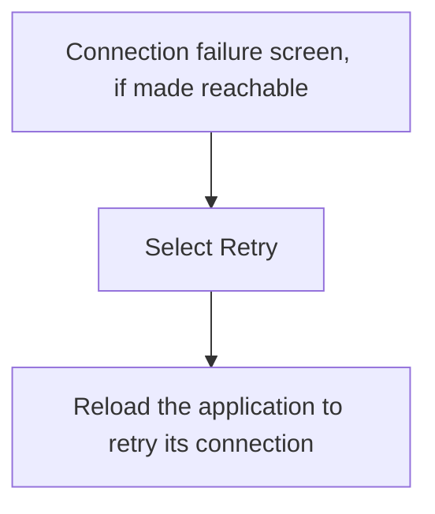
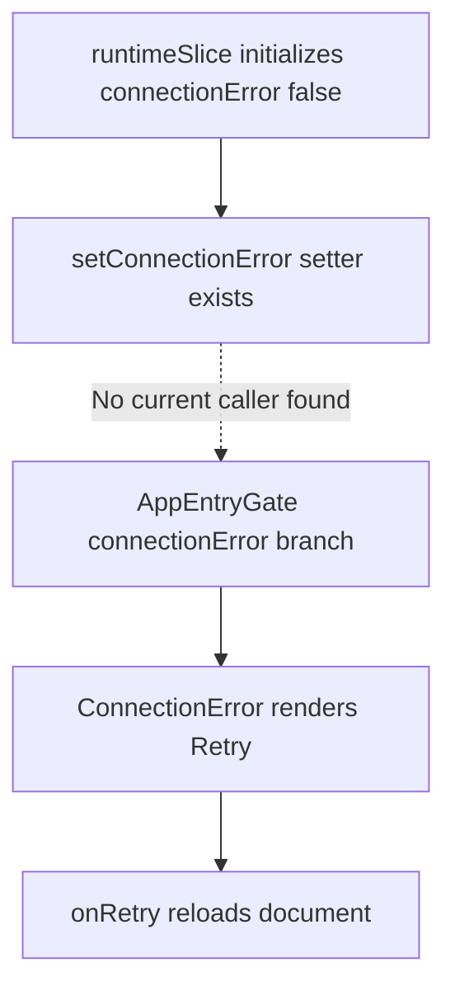

# US-NAV-19 — Retry after a server connection failure

As a company member, I want to retry when the application cannot connect to the server so that I can resume after service returns.

**Status:** Hidden — retained screen with no current error-state producer.

**Access:** Owner, Admin, Editor, Viewer

**Entry:** No current entry; retained connection-failure recovery screen.

**Documentation:** [When something goes wrong](../../docs-src/self-hosting/incidents.md)

**Source:** [ConnectionError.tsx](../../apps/frontend/src/components/ConnectionError.tsx); [AppEntryGate.tsx](../../apps/frontend/src/components/AppEntryGate.tsx)

## Acceptance criteria

- A connection failure shows a Retry action that reloads the application and retries its server connection; no local reset action is offered.

## User flow

Intended flow only: the retained screen is not reachable through the current application.

## Code flow

**Code references:** [runtimeSlice.ts](../../apps/frontend/src/store/slices/runtimeSlice.ts); [AppShell.tsx](../../apps/frontend/src/components/AppShell.tsx); [AppEntryGate.tsx](../../apps/frontend/src/components/AppEntryGate.tsx); [ConnectionError.tsx](../../apps/frontend/src/components/ConnectionError.tsx), [runtimeSlice.ts](../../apps/frontend/src/store/slices/runtimeSlice.ts)
