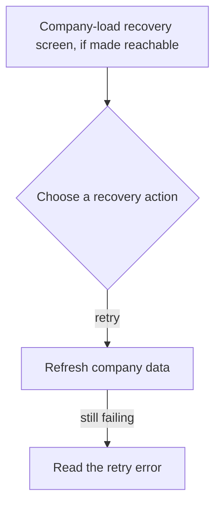
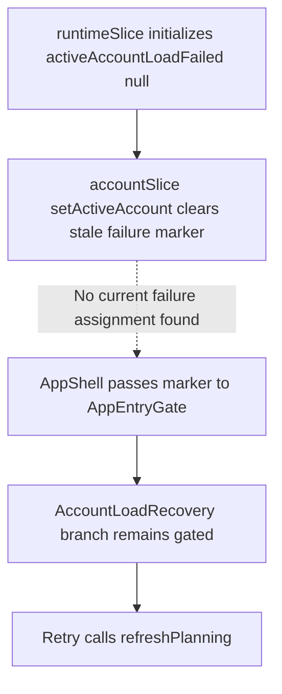

# US-NAV-20 — Recover when the active company fails to load

As a company member, I want to retry loading the active company so that I can continue if its planning data becomes available.

**Status:** Hidden — retained screen with no current error-state producer.

**Access:** Owner, Admin, Editor, Viewer.

**Entry:** No current entry; retained company-load recovery screen.

**Documentation:** [When something goes wrong](../../docs-src/self-hosting/incidents.md)

**Source:** [AccountLoadRecovery.tsx](../../apps/frontend/src/components/company/AccountLoadRecovery.tsx); [AppEntryGate.tsx](../../apps/frontend/src/components/AppEntryGate.tsx); [AppShell.tsx](../../apps/frontend/src/components/AppShell.tsx)

## Acceptance criteria

- Retry attempts to refresh the failed active company's planning data and reports a failed retry.

## User flow

Intended flow only: the retained screen is not reachable through the current application.

## Code flow

**Code references:** [runtimeSlice.ts](../../apps/frontend/src/store/slices/runtimeSlice.ts); [accountSlice.ts](../../apps/frontend/src/store/slices/accountSlice.ts); [useStore.ts](../../apps/frontend/src/store/useStore.ts); [AppShell.tsx](../../apps/frontend/src/components/AppShell.tsx); [AppEntryGate.tsx](../../apps/frontend/src/components/AppEntryGate.tsx); [AccountLoadRecovery.tsx](../../apps/frontend/src/components/company/AccountLoadRecovery.tsx)
