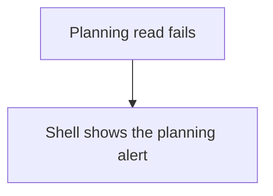
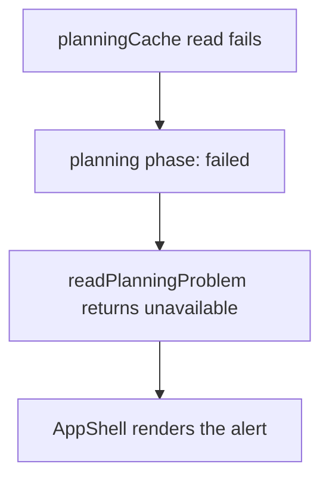

# US-NAV-20 — Recover when the active company fails to load

As a company member, I want to retry loading the active company so that I can continue if its planning data becomes available.

**Status:** Removed — the company-load recovery screen had no producer and was deleted; a failed planning read shows the shell's planning alert.

**Access:** Owner, Admin, Editor, Viewer.

**Entry:** None.

**Documentation:** [When something goes wrong](../../docs-src/self-hosting/incidents.md)

**Source:** [router.tsx](../../apps/frontend/src/router.tsx); [AppShell.tsx](../../apps/frontend/src/components/AppShell.tsx); [planningNotices.ts](../../apps/frontend/src/data/planning/planningNotices.ts)

## Acceptance criteria

- No separate recovery screen exists; a failed planning read is shown by the shell's planning alert.

## User flow

Unavailable: the screen was removed.

## Code flow

**Code references:** [planningCache.ts](../../apps/frontend/src/data/planning/planningCache.ts); [planningNotices.ts](../../apps/frontend/src/data/planning/planningNotices.ts); [AppShell.tsx](../../apps/frontend/src/components/AppShell.tsx)
