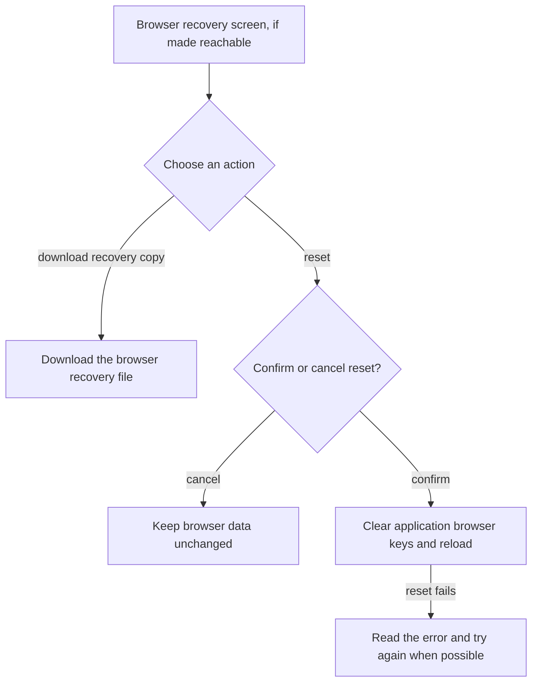
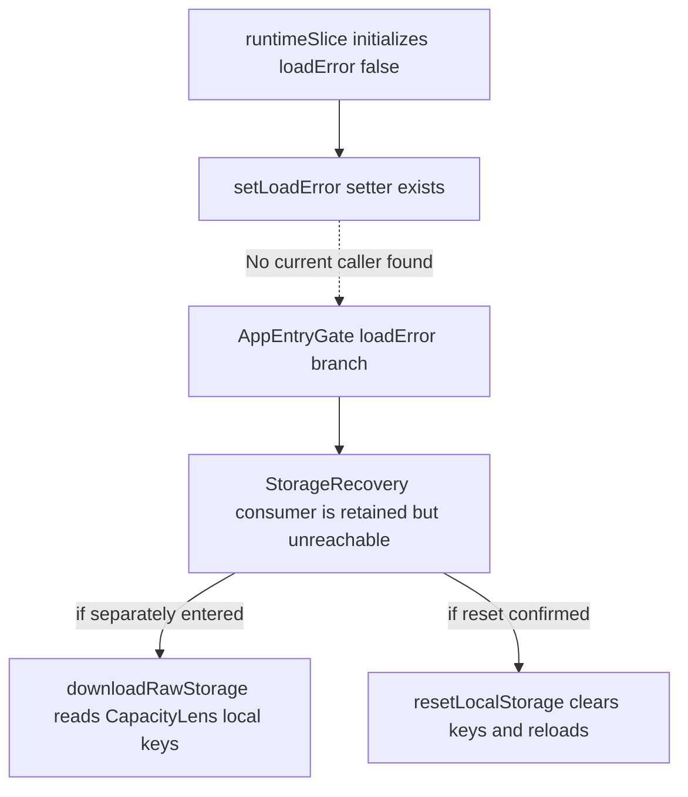

# US-NAV-21 — Recover unreadable browser storage

As a browser user, I want to download the browser data and confirm a reset when local data cannot be read so that I can preserve a copy before recovery.

**Status:** Hidden — retained screen with no current error-state producer.

**Access:** Anyone whose local browser data triggers the storage recovery screen; no company role applies.

**Entry:** No current entry; retained browser-storage recovery screen.

**Documentation:** [When something goes wrong](../../docs-src/self-hosting/incidents.md)

**Source:** [StorageRecovery.tsx](../../apps/frontend/src/components/StorageRecovery.tsx); [AppEntryGate.tsx](../../apps/frontend/src/components/AppEntryGate.tsx); [clearLocalStorage.ts](../../apps/frontend/src/data/clearLocalStorage.ts)

## Acceptance criteria

- Download data saves a JSON copy of CapacityLens browser storage. Reset stored data requires explicit confirmation, clears the local application data, and reloads; cancelling leaves stored bytes unchanged. Download and reset failures remain visible.

## User flow

Intended flow only: the retained screen is not reachable through the current application.

## Code flow

**Code references:** [runtimeSlice.ts](../../apps/frontend/src/store/slices/runtimeSlice.ts); [AppEntryGate.tsx](../../apps/frontend/src/components/AppEntryGate.tsx); [StorageRecovery.tsx](../../apps/frontend/src/components/StorageRecovery.tsx); [clearLocalStorage.ts](../../apps/frontend/src/data/clearLocalStorage.ts); [download.ts](../../apps/frontend/src/lib/download.ts)
