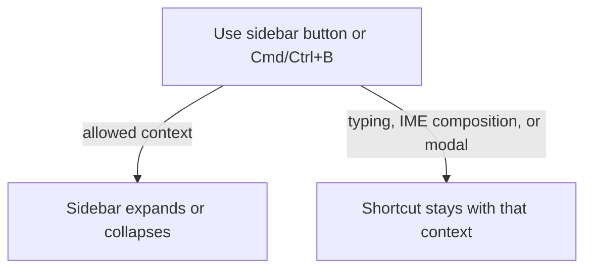
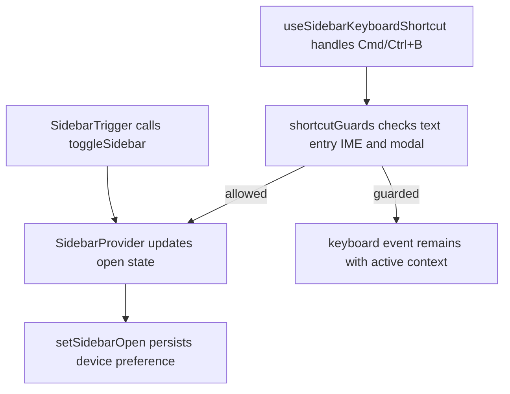

# US-NAV-22 — Collapse or expand desktop navigation

As a company member, I want to collapse or expand the desktop sidebar so that I can choose how much screen space navigation uses.

**Status:** Current

**Access:** Owner, Admin, Editor, Viewer; also available in demo mode.

**Entry:** Sidebar header button (accessible name **Collapse menu** or **Expand menu**); ⌘B on macOS or Ctrl+B on Windows/Linux.

**Documentation:** [Read the schedule](../../docs-src/using/read-the-schedule.md)

**Source:** [AppSidebar.tsx](../../apps/frontend/src/components/AppSidebar.tsx); [sidebar.tsx](../../apps/frontend/src/components/ui/sidebar.tsx); [DECISIONS.md](../../DECISIONS.md)

## Acceptance criteria

- The header button and shortcut toggle the desktop sidebar between expanded and icon-only states. The button’s accessible name tracks the action. The shortcut yields while text entry, IME composition, or a modal owns the keyboard.

## User flow

## Code flow

**Code references:** [AppSidebar.tsx](../../apps/frontend/src/components/AppSidebar.tsx); [sidebar.tsx](../../apps/frontend/src/components/ui/sidebar.tsx); [shortcutGuards.ts](../../apps/frontend/src/lib/shortcutGuards.ts); [runtimeSlice.ts](../../apps/frontend/src/store/slices/runtimeSlice.ts)
