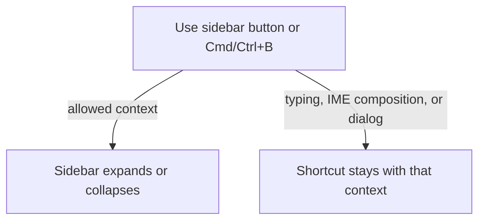
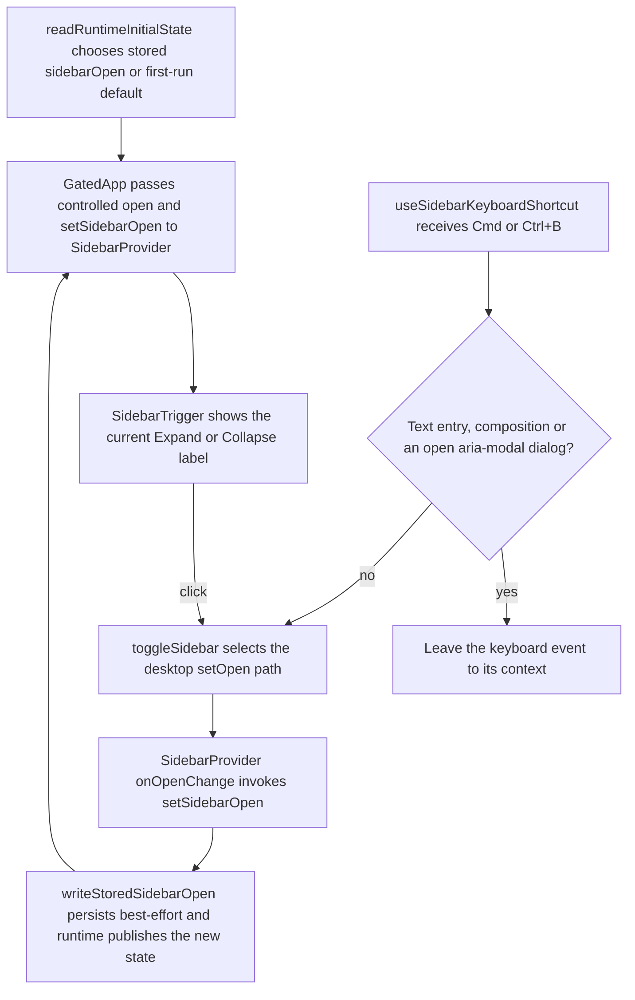

# US-NAV-22 — Collapse or expand desktop navigation

As a company member, I want to collapse or expand the desktop sidebar so that I can choose how much screen space navigation uses.

**Status:** Current

**Access:** Owner, Admin, Editor, Viewer.

**Entry:** Sidebar header button (accessible name **Collapse menu** or **Expand menu**); ⌘B or Ctrl+B.

**Documentation:** [Read the schedule](../../docs-src/using/read-the-schedule.md)

**Source:** [AppSidebar.tsx](../../apps/frontend/src/components/AppSidebar.tsx); [sidebar.tsx](../../apps/frontend/src/components/ui/sidebar.tsx); [DECISIONS.md](../../DECISIONS.md)

## Acceptance criteria

- The header button and shortcut toggle the desktop sidebar between expanded and icon-only states. The button’s accessible name tracks the action. The shortcut yields while text entry, IME composition, or a dialog owns the keyboard.

## User flow

## Code flow

The keyboard guard identifies a dialog by its open aria-modal marker. See [US-NAV-09](US-NAV-09-mobile-affordances.md#code-flow) for the mobile sheet.

**Code references:** [AppSidebar.tsx:76](../../apps/frontend/src/components/AppSidebar.tsx#L76) · [AppShell.tsx:110](../../apps/frontend/src/components/AppShell.tsx#L110) · [sidebar.tsx:76](../../apps/frontend/src/components/ui/sidebar.tsx#L76) · [sidebar.tsx:123](../../apps/frontend/src/components/ui/sidebar.tsx#L123) · [shortcutFilters.ts:18](../../apps/frontend/src/lib/shortcutFilters.ts#L18) · [runtimeSlice.ts:72](../../apps/frontend/src/store/slices/runtimeSlice.ts#L72) · [runtimeSlice.ts:130](../../apps/frontend/src/store/slices/runtimeSlice.ts#L130)
