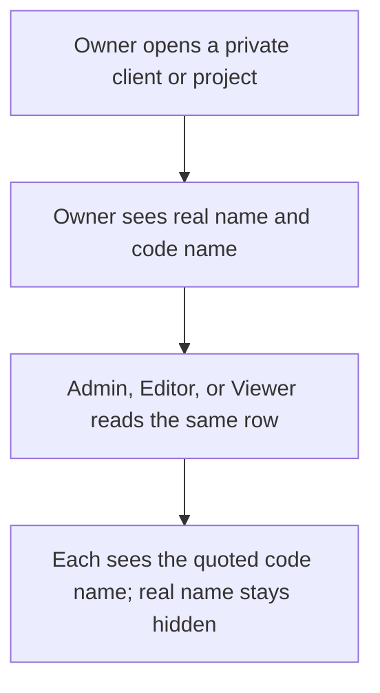
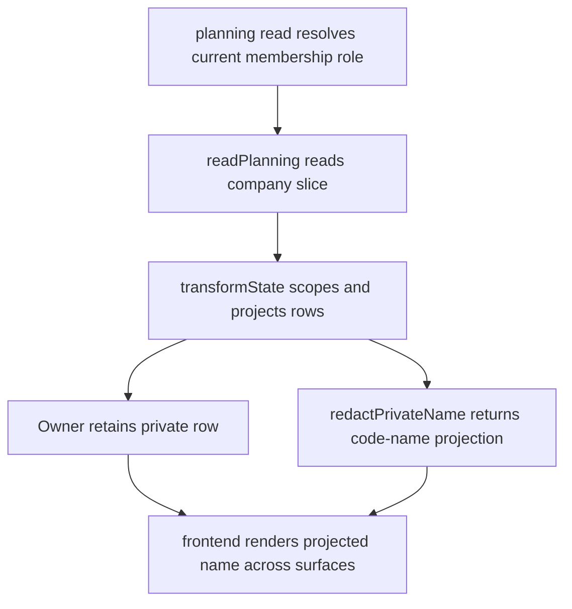

# US-PRI-01 — Show private names according to role

As a company Owner, I want private client and project names visible only to Owners so that confidential identities are protected.

**Status:** Current

**Access:** Owner sees real name and code name; Admin, Editor, Viewer receive only quoted code name

**Entry:** Client and Project lists, selectors, schedule, search, forms, and archived views

**Documentation:** [Privacy](../../docs-src/security/privacy.md)

**Source:** [state_transformer.ts](../../apps/backend/app/transformers/state_transformer.ts); [native_authorization.spec.ts](../../apps/backend/tests/functional/auth/native_authorization.spec.ts)

## Acceptance criteria

- Non-Owners never receive the real private name or raw code name; all applicable surfaces show the same projected label.

## User flow

## Code flow

**Code references:** [planning.ts](../../apps/backend/app/services/planning.ts); [state_transformer.ts](../../apps/backend/app/transformers/state_transformer.ts); [privateNames.ts](../../packages/shared/src/domain/privateNames.ts); [ClientList.tsx](../../apps/frontend/src/components/clients/ClientList.tsx); [ProjectList.tsx](../../apps/frontend/src/components/projects/ProjectList.tsx)
