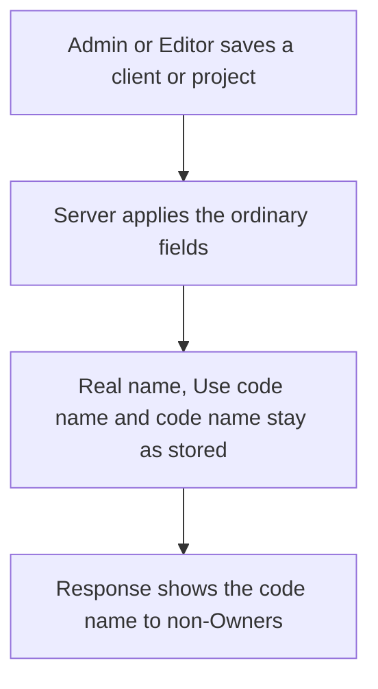
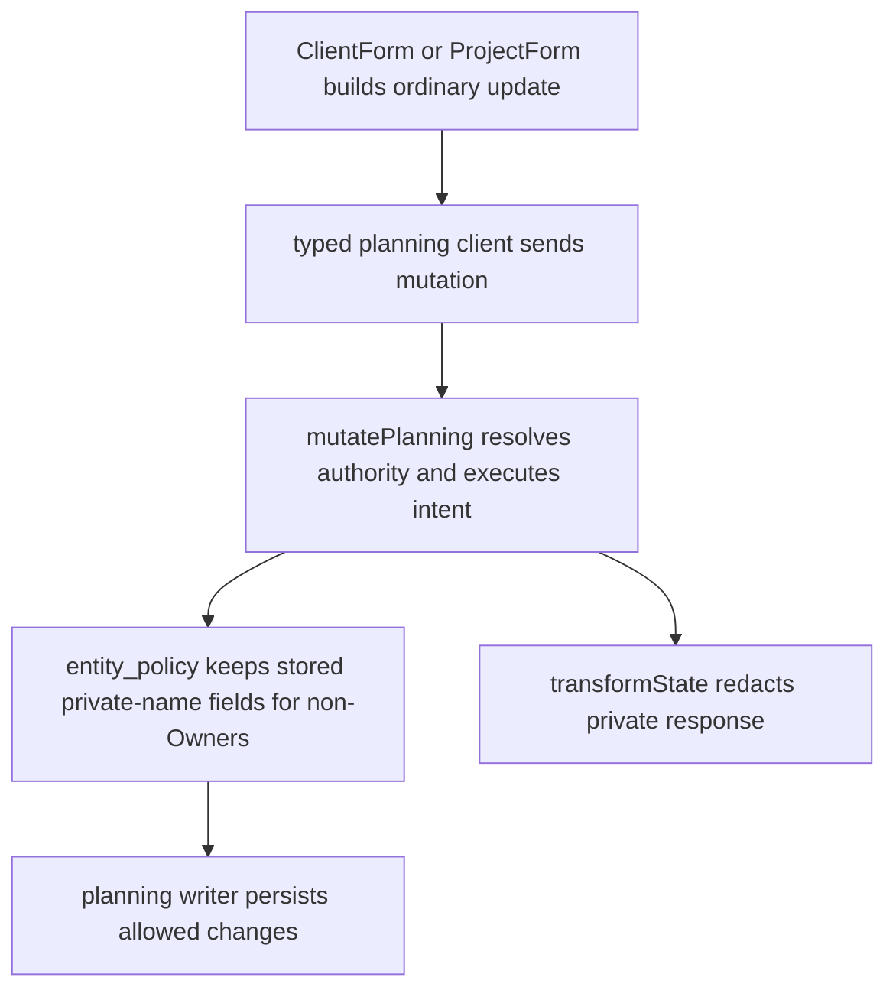

# US-PRI-02 — Preserve protected names on non-Owner writes

As a company Owner, I want permitted non-Owner edits to preserve private identity fields so that ordinary changes cannot expose or overwrite them.

**Status:** Current

**Access:** Owner may manage privacy fields; Admin and Editor may make permitted ordinary edits; Viewer is read-only

**Entry:** Client and Project create/update and lifecycle operations

**Documentation:** [Privacy](../../docs-src/security/privacy.md)

**Source:** [native_authorization.spec.ts](../../apps/backend/tests/functional/auth/native_authorization.spec.ts)

## Acceptance criteria

- When an Admin or Editor saves a client or project that uses a code name, the server keeps its real name, Use code name and code name as stored and applies only the other fields; nothing is refused.
- A non-Owner cannot turn on Use code name for a public record. Responses to non-Owners show the code name in place of the real name. Owners can change every privacy field.

## User flow

## Code flow

**Code references:** [ClientForm.tsx](../../apps/frontend/src/components/clients/ClientForm.tsx); [ProjectForm.tsx](../../apps/frontend/src/components/projects/ProjectForm.tsx); [typedPlanningActions.ts](../../apps/frontend/src/store/typedPlanningActions.ts); [planningTransport.ts](../../apps/frontend/src/data/planning/planningTransport.ts); [planning.ts](../../apps/backend/app/services/planning.ts); [entity_policy.ts](../../apps/backend/app/services/planning/entity_policy.ts); [writer.ts](../../apps/backend/app/services/planning/writer.ts); [state_transformer.ts](../../apps/backend/app/transformers/state_transformer.ts)
