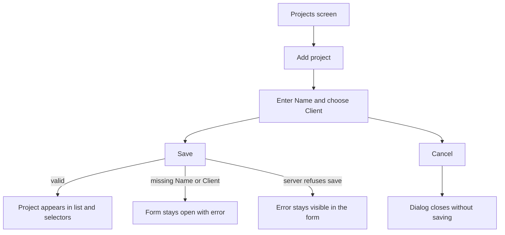
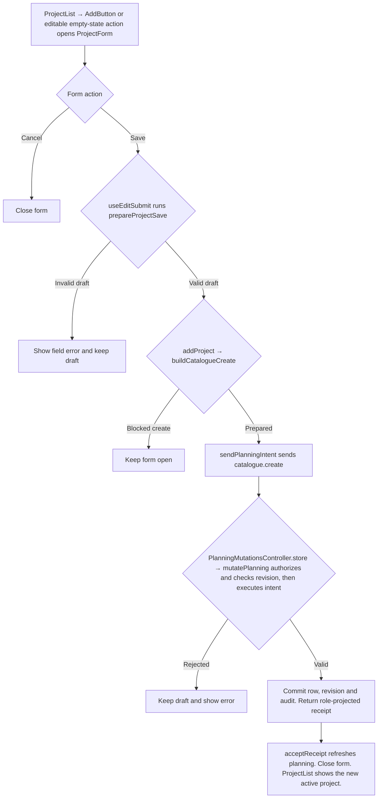

# US-PRJ-01 — Add a project (must belong to a client)

As an Editor, I want to add a project under a client so that it can be scheduled and filtered.

**Status:** Current
**Access:** Editor and above (Editor, Admin, Owner)
**Entry:** Projects screen → Add project
**Documentation:** [Guide](../../docs-src/using/projects.md)
**Source:** [ProjectList.tsx](../../apps/frontend/src/components/projects/ProjectList.tsx) · [ProjectForm.tsx](../../apps/frontend/src/components/projects/ProjectForm.tsx)

## Acceptance criteria

| Field         | Control         | Required/default/conditions                                            |
| ------------- | --------------- | ---------------------------------------------------------------------- |
| Client        | Picker          | Required; no default; Internal first, then active clients by name      |
| Name          | Text field      | Required; initially blank                                              |
| Use code name | Switch          | Owner only; off by default                                             |
| Code name     | Text field      | Owner only; shown and required when Use code name is on                |
| Colour        | Preset swatches | Defaults to project colour #da2d92; hidden when the client is Internal |

- **Save** adds the project. Invalid required values keep the form open with an error. **Cancel** closes without saving.

## User flow

## Code flow

Owner, Admin and Editor can write planning data. Viewer and view-as-member lack write authority. The write goes through `POST /api/v1/companies/:companyId/planning/mutations` with admitted company access. The planning cache refreshes on a stale revision and reconciles an uncertain write before another attempt. Footer Cancel closes the form, including during a pending save. The dispatched save can still settle. ProjectForm builds active client options with Internal first, requires a client and hides the colour picker for Internal. Internal display colour is resolved from the client; the form still submits a preset colour. Owners may create a private project. Creation does not trigger restoration cleanup.

**Code references:** [ProjectList.tsx](../../apps/frontend/src/components/projects/ProjectList.tsx#L69) · [ProjectForm.tsx](../../apps/frontend/src/components/projects/ProjectForm.tsx#L151) · [color.ts](../../packages/shared/src/lib/color.ts#L90) · [usePrivateNameFields.ts](../../apps/frontend/src/components/common/usePrivateNameFields.ts#L27) · [restricted_fields.ts](../../apps/backend/app/services/planning/restricted_fields.ts#L21) · [mutation_changes.ts](../../apps/backend/app/services/planning/mutation_changes.ts#L74) · [Confirmation retry](../../apps/frontend/src/data/planning/planningCache.ts#L420) · [Role projection](../../apps/backend/app/transformers/state_transformer.ts#L46) · [domain.ts](../../apps/backend/app/services/planning/entity_validation/domain.ts#L43) · [Write controls](../../apps/frontend/src/components/common/crudButtons.tsx#L7) · [Cancel button](../../apps/frontend/src/components/common/FormButtons.tsx#L17) · [useEditSubmit.ts](../../apps/frontend/src/hooks/useEditSubmit.ts#L44) · [Row checks](../../apps/backend/app/services/planning/entity_write_service.ts#L91) · [typedPlanningActions.ts](../../apps/frontend/src/store/typedPlanningActions.ts#L187) · [planningIntents.ts](../../apps/frontend/src/data/planning/planningIntents.ts#L426) · [sendPlanningIntent](../../apps/frontend/src/store/slices/planningSessionSlice.ts#L139) · [Planning transport](../../apps/frontend/src/data/planning/planningTransport.ts#L64) · [Planning route](../../apps/backend/start/routes/planning.ts#L16) · [Mutation controller](../../apps/backend/app/controllers/planning_mutations_controller.ts#L19) · [Planning transaction](../../apps/backend/app/services/planning_service.ts#L222) · [Company write authority](../../apps/backend/app/services/planning/planning_access_service.ts#L31) · [Receipt and refresh](../../apps/frontend/src/data/planning/planningCache.ts#L469)
