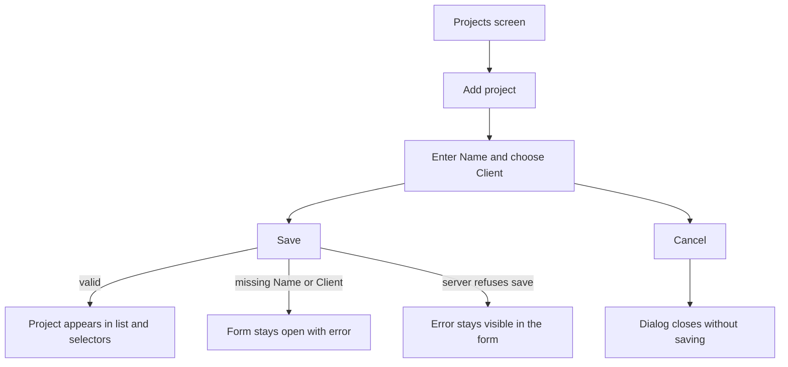
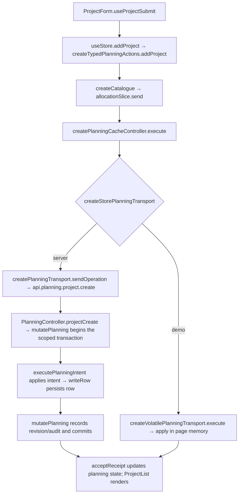

# US-PRJ-01 — Add a project (must belong to a client)

As an Editor, I want to add a project under a client so that it can be scheduled and filtered.

**Status:** Current
**Access:** Editor and above (Editor, Admin, Owner)
**Entry:** Projects screen → Add project
**Documentation:** [Guide](../../docs-src/using/projects.md)
**Source:** [ProjectList.tsx](../../apps/frontend/src/components/projects/ProjectList.tsx) · [ProjectForm.tsx](../../apps/frontend/src/components/projects/ProjectForm.tsx)

## Acceptance criteria

| Field         | Control         | Required/default/conditions                                            |
| ------------- | --------------- | ---------------------------------------------------------------------- |
| Client        | Picker          | Required; no default; Internal first, then active clients by name      |
| Name          | Text field      | Required; initially blank                                              |
| Use code name | Switch          | Owner only (anyone in demo mode); off by default                       |
| Code name     | Text field      | Owner only; shown and required when Use code name is on                |
| Colour        | Preset swatches | Defaults to project colour #da2d92; hidden when the client is Internal |

- **Save** adds the project. Invalid required values keep the form open with an error. **Cancel** closes without saving.

## User flow

## Code flow

**Code references:** [ProjectForm.tsx](../../apps/frontend/src/components/projects/ProjectForm.tsx) · [typedPlanningActions.ts](../../apps/frontend/src/store/typedPlanningActions.ts) · [allocationSlice.ts](../../apps/frontend/src/store/slices/allocationSlice.ts) · [planningCacheController.ts](../../apps/frontend/src/data/planning/planningCacheController.ts) · [storePlanningTransport.ts](../../apps/frontend/src/data/planning/storePlanningTransport.ts) · [planningTransport.ts](../../apps/frontend/src/data/planning/planningTransport.ts) · [volatilePlanningTransport.ts](../../apps/frontend/src/data/planning/volatilePlanningTransport.ts) · [planning_routes.ts](../../apps/backend/start/planning_routes.ts) · [planning_controller.ts](../../apps/backend/app/controllers/planning_controller.ts) · [planning.ts](../../apps/backend/app/services/planning.ts) · [execute.ts](../../apps/backend/app/services/planning/execute.ts) · [writer.ts](../../apps/backend/app/services/planning/writer.ts)
