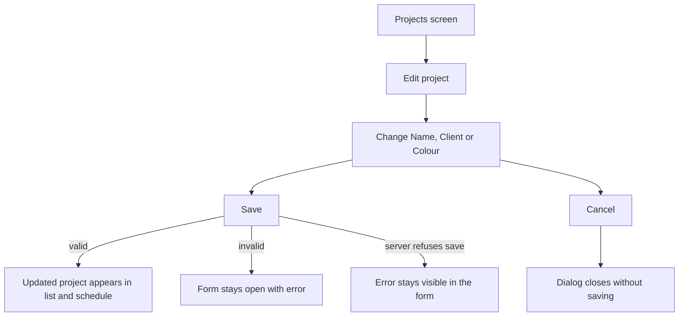
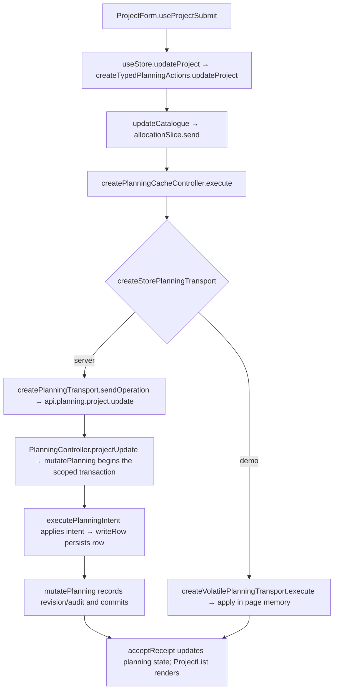

# US-PRJ-02 — Edit a project

As an Editor, I want to edit a project’s name, client and colour so that its updated details appear throughout the schedule.

**Status:** Current
**Access:** Editor and above (Editor, Admin, Owner)
**Entry:** Projects screen → project row → Edit
**Documentation:** [Guide](../../docs-src/using/projects.md)
**Source:** [ProjectList.tsx](../../apps/frontend/src/components/projects/ProjectList.tsx) · [ProjectForm.tsx](../../apps/frontend/src/components/projects/ProjectForm.tsx)

## Acceptance criteria

| Field         | Control         | Required/default/conditions                                                              |
| ------------- | --------------- | ---------------------------------------------------------------------------------------- |
| Name          | Text field      | Required; current value prefilled                                                        |
| Client        | Picker          | Required; active clients and Internal, plus the selected archived client when applicable |
| Use code name | Switch          | Owner only; current value prefilled                                                      |
| Code name     | Text field      | Owner only; required when Use code name is on                                            |
| Colour        | Preset swatches | Current colour preselected; hidden for Internal projects                                 |

- **Save** updates the project. Invalid required values keep the form open with an error. **Cancel** closes without saving.

## User flow

## Code flow

**Code references:** [ProjectForm.tsx](../../apps/frontend/src/components/projects/ProjectForm.tsx) · [typedPlanningActions.ts](../../apps/frontend/src/store/typedPlanningActions.ts) · [allocationSlice.ts](../../apps/frontend/src/store/slices/allocationSlice.ts) · [planningCacheController.ts](../../apps/frontend/src/data/planning/planningCacheController.ts) · [storePlanningTransport.ts](../../apps/frontend/src/data/planning/storePlanningTransport.ts) · [planningTransport.ts](../../apps/frontend/src/data/planning/planningTransport.ts) · [volatilePlanningTransport.ts](../../apps/frontend/src/data/planning/volatilePlanningTransport.ts) · [planning_routes.ts](../../apps/backend/start/planning_routes.ts) · [planning_controller.ts](../../apps/backend/app/controllers/planning_controller.ts) · [planning.ts](../../apps/backend/app/services/planning.ts) · [execute.ts](../../apps/backend/app/services/planning/execute.ts) · [writer.ts](../../apps/backend/app/services/planning/writer.ts)
