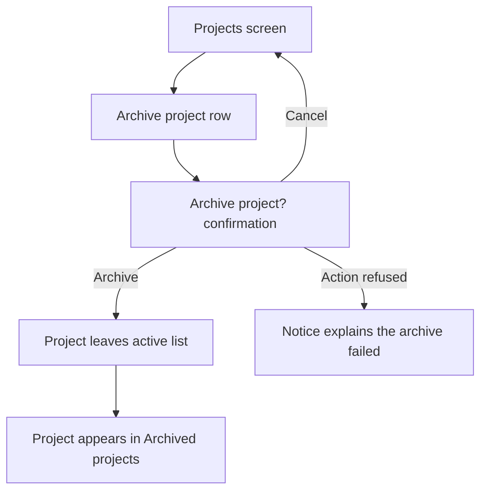
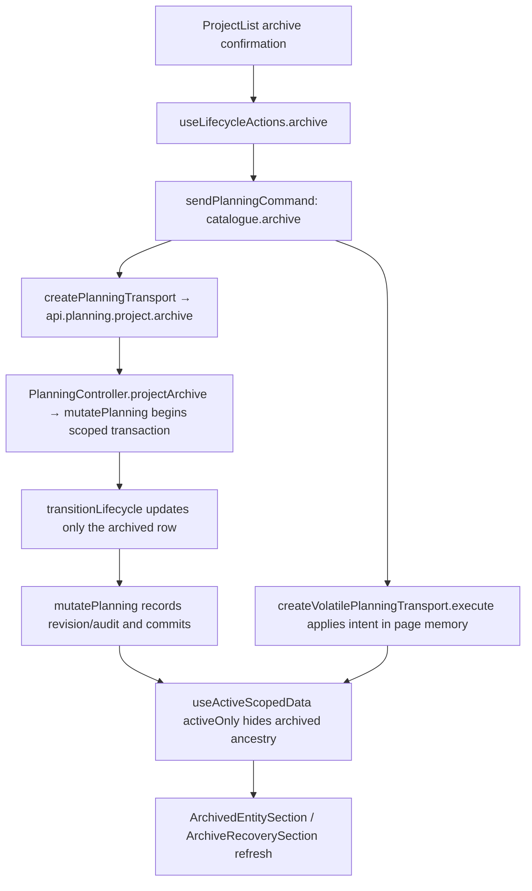

# US-PRJ-03 — Archive a project

As an Editor, I want to archive a project so that its work leaves active views while remaining restorable.

**Status:** Current
**Access:** Editor and above (Editor, Admin, Owner)
**Entry:** Projects screen → project row → Archive {project name}
**Documentation:** [Guide](../../docs-src/using/projects.md)
**Source:** [ProjectList.tsx](../../apps/frontend/src/components/projects/ProjectList.tsx) · [ArchivedEntitySection.tsx](../../apps/frontend/src/components/common/ArchivedEntitySection.tsx)

## Acceptance criteria

- Selecting **Archive {name}** opens **Archive project?** with **Archive** and **Cancel** controls.
- The dialog explains that phases and allocations are hidden and restorable; when present, their counts are shown.
- **Cancel** closes the dialog without archiving. **Archive** archives the record.
- The archived record appears in its archived section with a **Restore** control.

## User flow

## Code flow

**Code references:** [ProjectList.tsx](../../apps/frontend/src/components/projects/ProjectList.tsx) · [ArchivedEntitySection.tsx](../../apps/frontend/src/components/common/ArchivedEntitySection.tsx) · [ArchiveRecoverySection.tsx](../../apps/frontend/src/components/common/ArchiveRecoverySection.tsx) · [useScopedData.ts](../../apps/frontend/src/store/useScopedData.ts) · [lifecycle.ts](../../packages/shared/src/domain/lifecycle.ts) · [useLifecycleActions.ts](../../apps/frontend/src/hooks/useLifecycleActions.ts) · [allocationSlice.ts](../../apps/frontend/src/store/slices/allocationSlice.ts) · [planningCacheController.ts](../../apps/frontend/src/data/planning/planningCacheController.ts) · [storePlanningTransport.ts](../../apps/frontend/src/data/planning/storePlanningTransport.ts) · [planningTransport.ts](../../apps/frontend/src/data/planning/planningTransport.ts) · [volatilePlanningTransport.ts](../../apps/frontend/src/data/planning/volatilePlanningTransport.ts) · [planning_routes.ts](../../apps/backend/start/planning_routes.ts) · [planning_controller.ts](../../apps/backend/app/controllers/planning_controller.ts) · [planning.ts](../../apps/backend/app/services/planning.ts) · [execute.ts](../../apps/backend/app/services/planning/execute.ts)
