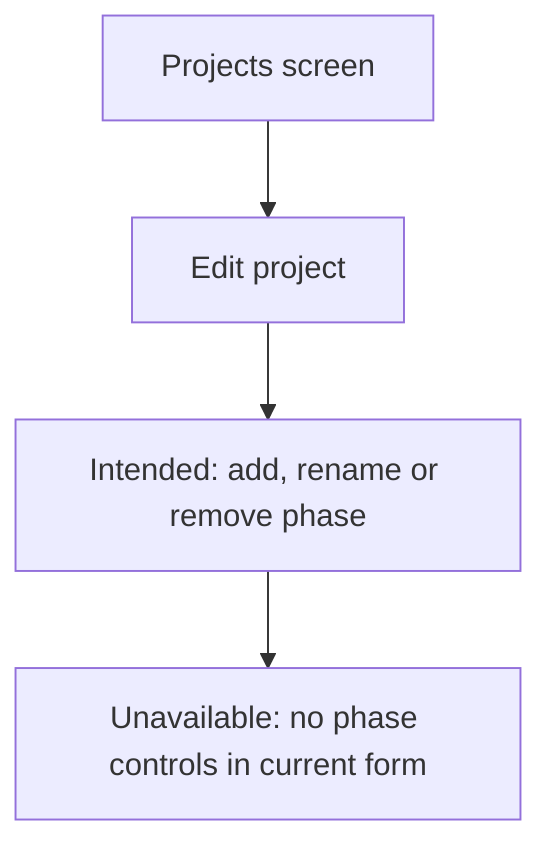
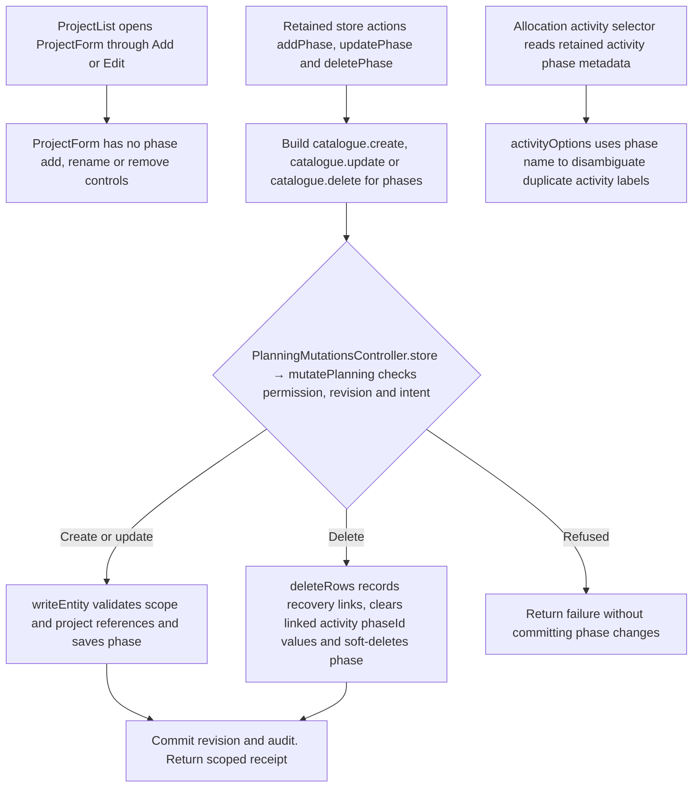

# US-PRJ-04 — Manage phases inside a project

As an Editor, I want to manage project phases so that activities can be associated with project stages.

**Status:** Hidden — phase controls are absent from the current project form; phase records remain in the data.
**Access:** Editor and above (Editor, Admin, Owner)
**Entry:** Projects screen → No current control (hidden)
**Documentation:** [Guide](../../docs-src/using/projects.md)
**Source:** [ProjectList.tsx](../../apps/frontend/src/components/projects/ProjectList.tsx) · [ProjectForm.tsx](../../apps/frontend/src/components/projects/ProjectForm.tsx)

## Acceptance criteria

The following are the retained intended controls, unavailable in the current UI.

| Field      | Control    | Required/default/conditions                                    |
| ---------- | ---------- | -------------------------------------------------------------- |
| Phase name | Text input | A name for each new phase; scoped to the project being edited. |

- Add or remove phases within the Project edit dialog, then Save the project.
- A new phase becomes selectable for that project's activities and allocations only.
- Removing a phase leaves its activities in place without a phase.

## User flow

**Unavailable today:** The intended flow cannot be performed because the Project form has no phase controls.

## Code flow

Phase management is hidden in the normal project journey. The retained store actions use the same admitted, company-scoped planning endpoint and write authority as catalogue forms. An unchanged update can produce no intent. The allocation form offers no independent Phase selector.

**Code references:** [ProjectList.tsx](../../apps/frontend/src/components/projects/ProjectList.tsx#L69) · [ProjectForm.tsx](../../apps/frontend/src/components/projects/ProjectForm.tsx#L151) · [typedPlanningActions.ts](../../apps/frontend/src/store/typedPlanningActions.ts#L190) · [planningIntents.ts](../../apps/frontend/src/data/planning/planningIntents.ts#L456) · [domain.ts](../../apps/backend/app/services/planning/entity_validation/domain.ts#L43) · [planning_execution_service.ts](../../apps/backend/app/services/planning/planning_execution_service.ts#L290) · [restoration_service.ts](../../apps/backend/app/services/planning/restoration_service.ts#L64) · [activityOptions.ts](../../apps/frontend/src/components/scheduler/activityOptions.ts#L33) · [AllocationTargetFields.tsx](../../apps/frontend/src/components/scheduler/AllocationTargetFields.tsx#L106) · [restoration_catalogue.spec.ts](../../apps/backend/tests/functional/planning/restoration_catalogue.spec.ts#L121) · [sendPlanningIntent](../../apps/frontend/src/store/slices/planningSessionSlice.ts#L139) · [Planning transport](../../apps/frontend/src/data/planning/planningTransport.ts#L64) · [Planning route](../../apps/backend/start/routes/planning.ts#L16) · [Mutation controller](../../apps/backend/app/controllers/planning_mutations_controller.ts#L19) · [Planning transaction](../../apps/backend/app/services/planning_service.ts#L222) · [Company write authority](../../apps/backend/app/services/planning/planning_access_service.ts#L31) · [Receipt and refresh](../../apps/frontend/src/data/planning/planningCache.ts#L469)
