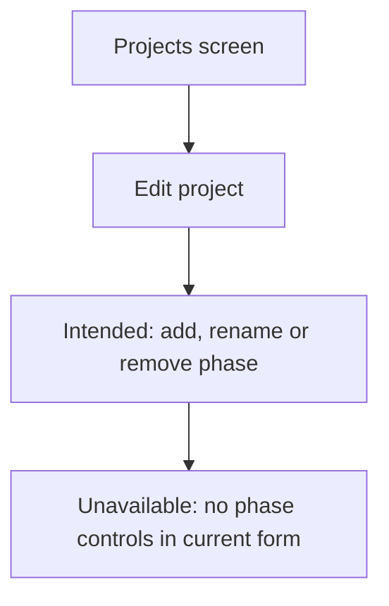
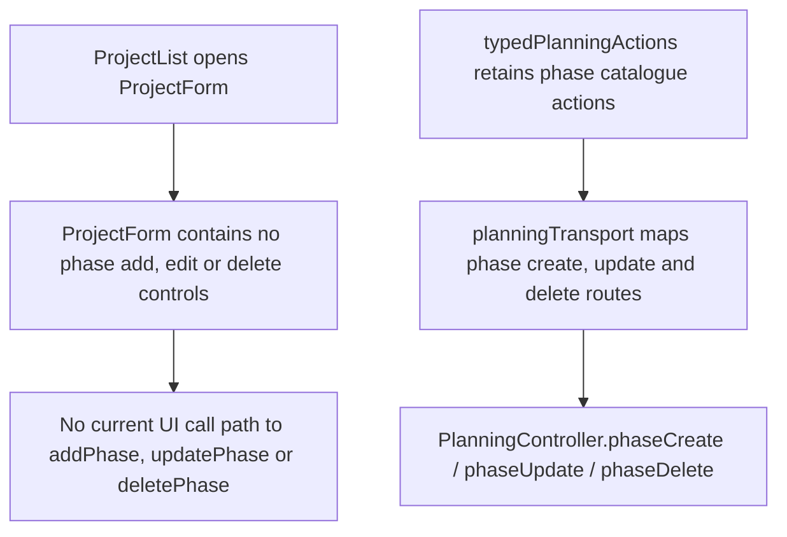

# US-PRJ-04 — Manage phases inside a project

As an Editor, I want to manage project phases so that activities can be associated with project stages.

**Status:** Hidden — phase controls are absent from the current project form; phase records remain in the data.
**Access:** Editor and above (Editor, Admin, Owner)
**Entry:** Projects screen → No current control (hidden)
**Documentation:** [Guide](../../docs-src/using/projects.md)
**Source:** [ProjectList.tsx](../../apps/frontend/src/components/projects/ProjectList.tsx) · [ProjectForm.tsx](../../apps/frontend/src/components/projects/ProjectForm.tsx)

## Acceptance criteria

The following are the retained intended controls, unavailable in the current UI.

| Field      | Control    | Required/default/conditions                                    |
| ---------- | ---------- | -------------------------------------------------------------- |
| Phase name | Text input | A name for each new phase; scoped to the project being edited. |

- Add or remove phases within the Project edit dialog, then Save the project.
- A new phase becomes selectable for that project's activities and allocations only.
- Removing a phase leaves its activities in place without a phase.

## User flow

**Unavailable today:** The intended flow cannot be performed because the Project form has no phase controls.

## Code flow

**Code references:** [ProjectList.tsx](../../apps/frontend/src/components/projects/ProjectList.tsx) · [ProjectForm.tsx](../../apps/frontend/src/components/projects/ProjectForm.tsx) · [typedPlanningActions.ts](../../apps/frontend/src/store/typedPlanningActions.ts) · [planningTransport.ts](../../apps/frontend/src/data/planning/planningTransport.ts) · [planning_routes.ts](../../apps/backend/start/planning_routes.ts) · [planning_controller.ts](../../apps/backend/app/controllers/planning_controller.ts) · [planning.ts](../../apps/backend/app/services/planning.ts) · [execute.ts](../../apps/backend/app/services/planning/execute.ts)
