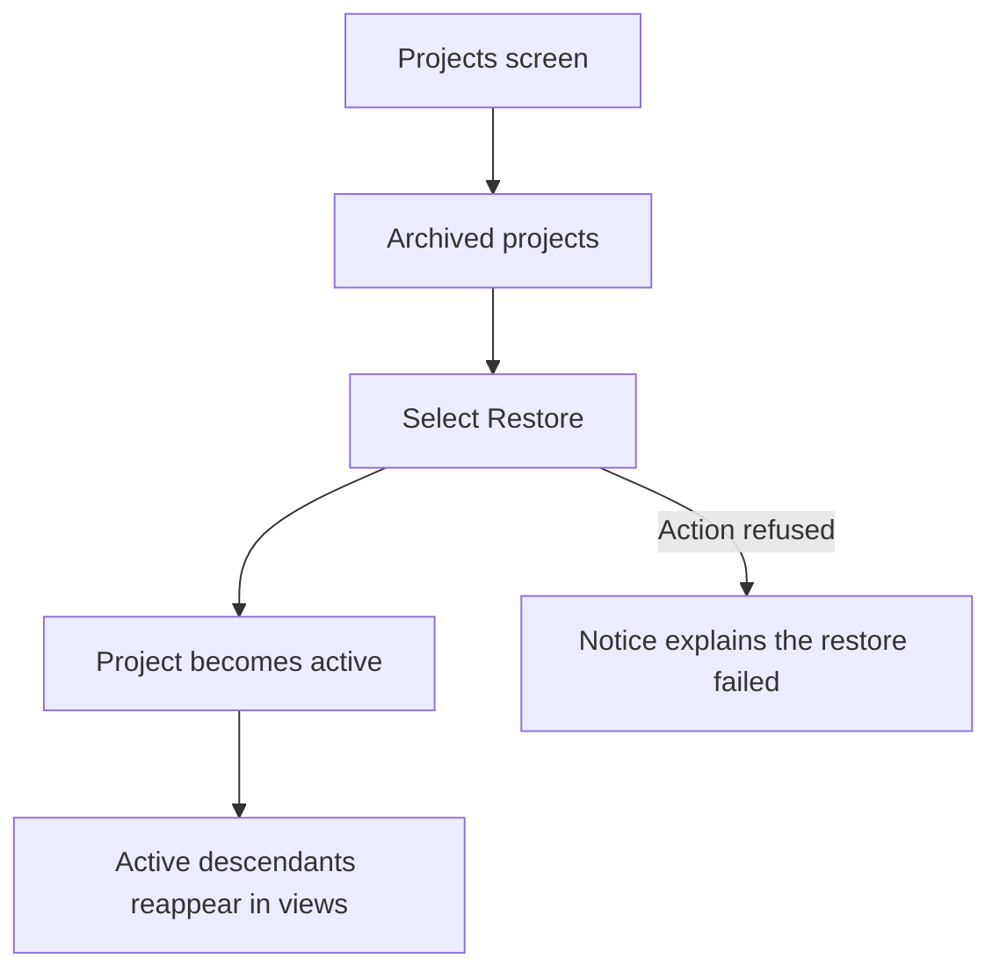
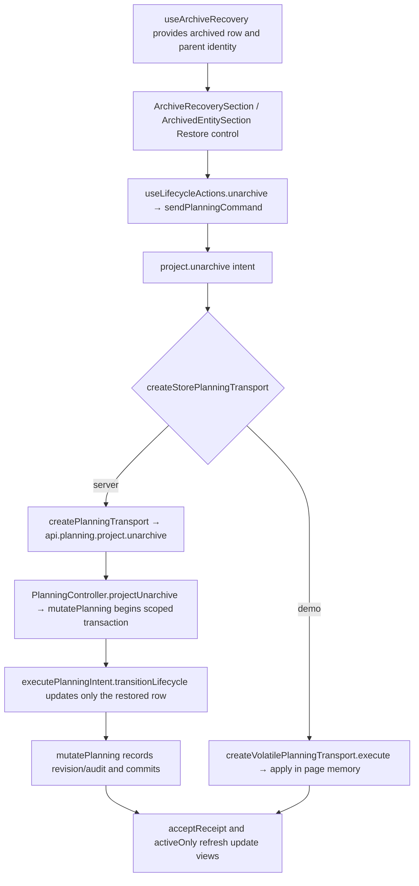

# US-PRJ-06 — Restore an archived project

As an Editor, I want to restore an archived project so that its active work returns to the catalogue and schedule.

**Status:** Current
**Access:** Editor and above (Editor, Admin, Owner)
**Entry:** Projects screen → Archived projects → Restore
**Documentation:** [Projects guide](../../docs-src/using/projects.md)
**Source:** [ProjectList.tsx](../../apps/frontend/src/components/projects/ProjectList.tsx) · [ArchivedEntitySection.tsx](../../apps/frontend/src/components/common/ArchivedEntitySection.tsx)

## Acceptance criteria

- A directly archived project has an accessible **Restore** control. Selecting it returns the project to active status and active views.
- A row hidden only by an archived parent links to **Restore archived parent**; restoring the parent reveals descendants that remain active.

## User flow

## Code flow

**Code references:** [ProjectList.tsx](../../apps/frontend/src/components/projects/ProjectList.tsx) · [ArchivedEntitySection.tsx](../../apps/frontend/src/components/common/ArchivedEntitySection.tsx) · [ArchiveRecoverySection.tsx](../../apps/frontend/src/components/common/ArchiveRecoverySection.tsx) · [useArchiveRecovery.ts](../../apps/frontend/src/hooks/useArchiveRecovery.ts) · [useLifecycleActions.ts](../../apps/frontend/src/hooks/useLifecycleActions.ts) · [allocationSlice.ts](../../apps/frontend/src/store/slices/allocationSlice.ts) · [planningCacheController.ts](../../apps/frontend/src/data/planning/planningCacheController.ts) · [storePlanningTransport.ts](../../apps/frontend/src/data/planning/storePlanningTransport.ts) · [planningTransport.ts](../../apps/frontend/src/data/planning/planningTransport.ts) · [volatilePlanningTransport.ts](../../apps/frontend/src/data/planning/volatilePlanningTransport.ts) · [planning_routes.ts](../../apps/backend/start/planning_routes.ts) · [planning_controller.ts](../../apps/backend/app/controllers/planning_controller.ts) · [planning.ts](../../apps/backend/app/services/planning.ts) · [execute.ts](../../apps/backend/app/services/planning/execute.ts)
