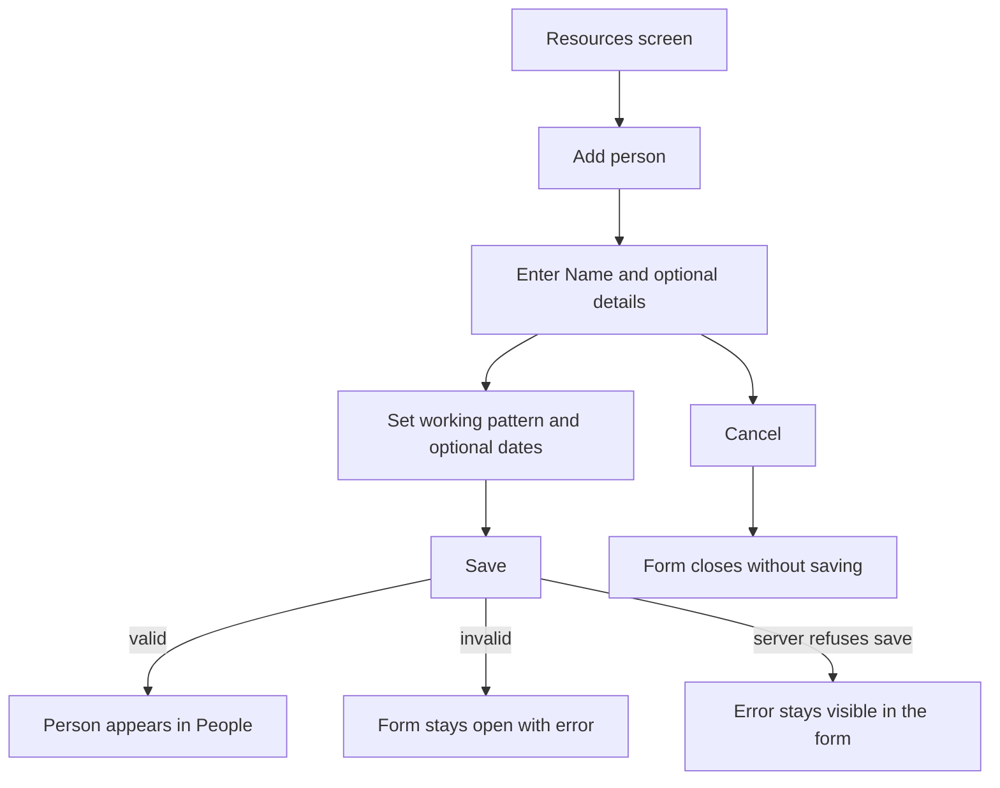
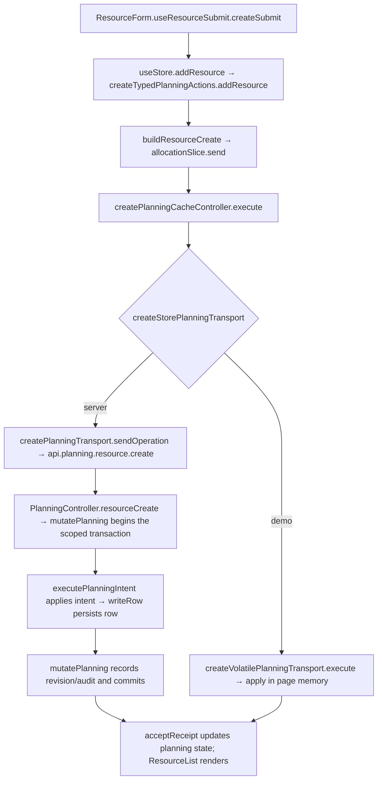

# US-RES-01 — Add a person resource

As an Editor, I want to add a person with a role, working pattern and optional team details so that the schedule reflects their capacity.

**Status:** Current
**Access:** Editor and above (Editor, Admin, Owner)
**Entry:** Resources screen → Add resource
**Documentation:** [Guide](../../docs-src/using/resources.md)
**Source:** [ResourceList.tsx](../../apps/frontend/src/components/resources/ResourceList.tsx) · [ResourceForm.tsx](../../apps/frontend/src/components/resources/ResourceForm.tsx)

## Acceptance criteria

| Field        | Control          | Required/default/conditions                                                                                                |
| ------------ | ---------------- | -------------------------------------------------------------------------------------------------------------------------- |
| Name         | Text field       | Required                                                                                                                   |
| Role         | Text field       | Optional                                                                                                                   |
| Discipline   | Picker           | Optional; "— None —" by default; shown when disciplines are enabled and at least one exists                                |
| Engagement   | Segmented choice | Studio or Supplementary; defaults to Studio                                                                                |
| Start date   | Date field       | Optional; unbounded when blank                                                                                             |
| End date     | Date field       | Optional; unbounded when blank; cannot be before Start date                                                                |
| Working days | Weekday picker   | Monday–Friday default Full day; Saturday and Sunday default Not working; at least one weekday must be Full day or Half day |

- **Save** adds the person to the People list; valid values are retained.

## User flow

## Code flow

**Code references:** [ResourceForm.tsx](../../apps/frontend/src/components/resources/ResourceForm.tsx) · [typedPlanningActions.ts](../../apps/frontend/src/store/typedPlanningActions.ts) · [allocationSlice.ts](../../apps/frontend/src/store/slices/allocationSlice.ts) · [planningCacheController.ts](../../apps/frontend/src/data/planning/planningCacheController.ts) · [storePlanningTransport.ts](../../apps/frontend/src/data/planning/storePlanningTransport.ts) · [planningTransport.ts](../../apps/frontend/src/data/planning/planningTransport.ts) · [volatilePlanningTransport.ts](../../apps/frontend/src/data/planning/volatilePlanningTransport.ts) · [planning_routes.ts](../../apps/backend/start/planning_routes.ts) · [planning_controller.ts](../../apps/backend/app/controllers/planning_controller.ts) · [planning.ts](../../apps/backend/app/services/planning.ts) · [execute.ts](../../apps/backend/app/services/planning/execute.ts) · [writer.ts](../../apps/backend/app/services/planning/writer.ts) · [useResourceSubmit.ts](../../apps/frontend/src/components/resources/useResourceSubmit.ts)
